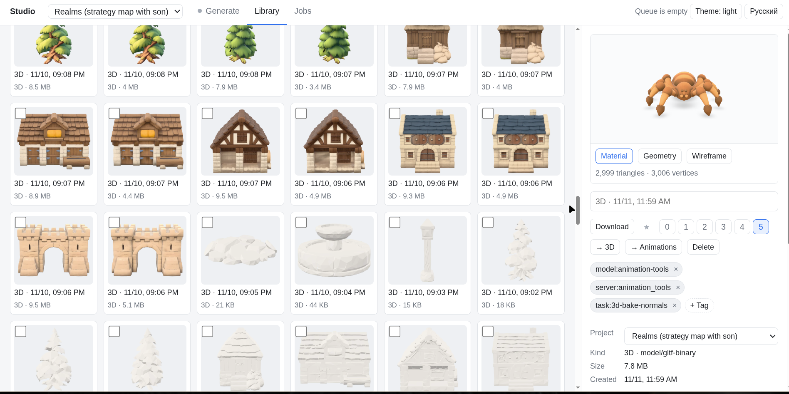
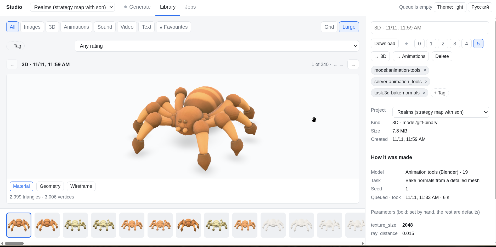
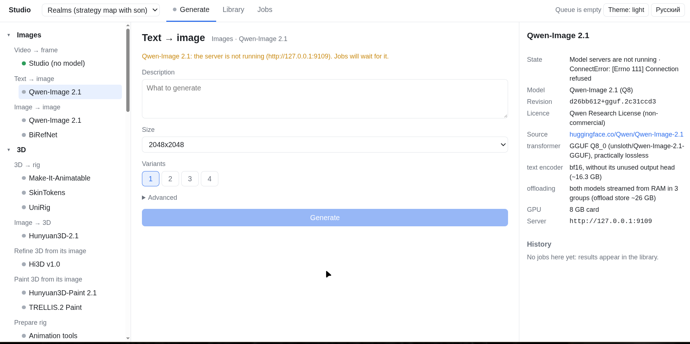

# Algorithmic Playground & Coding Challenges

> I find that I don't understand things unless I try to program them.
>
> &mdash; Donald Knuth

...What i program, i do not understand either.

This repository is a curated collection of my programming solutions,
algorithm experiments, and learning notes on my computer science
journey. You'll find both educational implementations and competitive
programming solutions.

**Note**: Code is written for educational purposes, not optimized for
production, and may contain errors.

## Asset Studio

[`assets_studio`](assets_studio) is a local studio for making game assets
with open generative models on a laptop with one 8 GB GPU: images, 3D
models with PBR textures, rigs and animation, speech, sound effects,
songs, text and short videos.

<!-- markdownlint-disable MD013 MD033 -->
<p>
  <a href="static/assets_studio/screenshot-2026-11-11-22-16-30.png"></a>
  <a href="static/assets_studio/screenshot-2026-11-11-22-16-47.png"></a>
  <a href="static/assets_studio/screenshot-2026-11-11-22-17-33.png"></a>
</p>
<!-- markdownlint-enable MD013 MD033 -->

- **One model, one server.** Every model runs in its own environment
  behind a common HTTP contract. A launcher starts the server a queued
  job needs and stops it afterwards, so a 27B language model and a 3D
  pipeline take turns on the same card.
- **For people and agents.** A web UI, a REST API and an MCP server:
  coding agents queue jobs, wait for them and read the results. A
  separate flow editor saves repeatable job graphs.

## Repository Structure

### Codeforces Solutions

[`cpp/codeforces`](cpp/codeforces) — Solutions from
[Codeforces](https://codeforces.com).

### Algorithms & Data Structures

[`cpp/warmup`](cpp/warmup) — Educational implementations of core
algorithms, data structures and techniques. Tests for this section
were written with the help of Gemini CLI.

### SICP solutions

[`lisp/sicp`](lisp/sicp) — My first experience in programming.


### Neural Network

[`neural_network/nn_lib`](neural_network/nn_lib) — An educational C++
implementation of a fully connected neural network and backpropagation
using only the standard library. It trains on a CPU to about 95%
accuracy on MNIST.

### Pet Project (Evolutionary Art)

[`pet_project`](pet_project) — An experimental evolutionary algorithm
that draws images using pixels, utilizing an ImageNet-trained model as
the fitness function. It "evolves" images from random pixels into
recognizable shapes.

### Steam Review Forecaster

[`qwen_review`](qwen_review) — A LoRA adapter for Qwen3.5 that forecasts
how many Steam reviews a game gets, and what share of them are
positive, from one screenshot with the release year, genres and tags.
It judges the look, not the game. On 3,315 games of 2026 held out from
training it put 78.3% of game pairs in the right order (chance is 50%).
The 2B adapter is on Hugging Face:
[zjgkkn/qwen3.5-2b-steam-reviews-lora](https://huggingface.co/zjgkkn/qwen3.5-2b-steam-reviews-lora).
Play against it in [Shot Call](https://shotcall.bonfirelit.dev/): of
two Steam games of one genre, pick the one with more reviews.

### Head Reader

[`frommhr`](frommhr) — Reads a bald head's shape and colour from two
pictures, the front and the profile, as Meta's MHR head coefficients
and 14 pigment sliders, for building 3D game characters. It was trained
only on synthetic renders of random MHR people on NVIDIA's SOMA mesh; on
held-out people the rebuilt head's skin lies 0.27 mm from the truth on
average. Assets Studio's `frommhr` server puts the head on a rigged,
textured person.

- Code: [`frommhr`](frommhr), from the training data to the published
  package.
- Model on Hugging Face:
  [zjgkkn/frommhr](https://huggingface.co/zjgkkn/frommhr), with the
  weights, the model card and an inference script.
- Studio server:
  [`assets_studio/model_servers/fromsoma`](assets_studio/model_servers/fromsoma).

### Shot Search

[`games/shotsearch`](games/shotsearch) — Finds Steam store screenshots
like yours among about 500,000 of them: by look (DINOv2: layout,
camera, forms, light) or by meaning (SigLIP 2: what is shown), with
each game's real reviews and a `qwen_review` forecast for the shot. A
browser UI and an MCP server for agents; runs on the CPU.

### Production Infrastructure

[`production`](production) — Production-grade infrastructure managed
with GitOps and infrastructure as code. It includes reproducible Bazel
builds, CI checks, speculative jobs, gated changes, and single sign-on
for deployed services.

### PipeLLM

[`pipellm`](pipellm) - A simple and lightweight CLI tool for working
with the **Gemini API** using named prompts and shell aliases:

```bash
cat error.txt | grep ERROR | summary | kharms
# → Everything has vanished like smoke, the file exists no more.
```

### Games

[`games`](games/README.md) — Small games created with LLM assistance,
largely for experimenting with and testing models.

### AI-Assisted Code

**Note**: Several parts of this repository were generated or assisted
by LLMs. Notably:

- [`pet_project`](pet_project) was partially generated by an LLM.
- [`cpp/warmup`](cpp/warmup) tests were automatically ported from BATS to
  GoogleTest.
- [`pipellm`](pipellm) heavily generated based on the project's design
  specs.
- [`assets_studio`](assets_studio) was written with Claude Code.

## Purpose

This repository showcases my journey in programming and
algorithms. Feel free to explore the code and use it as a
reference. All constructive feedback is appreciated!

---
