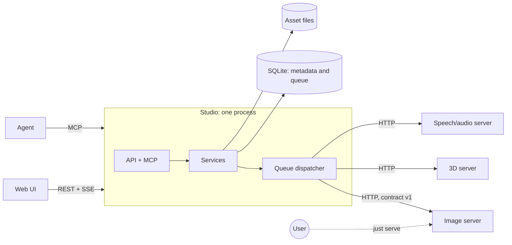
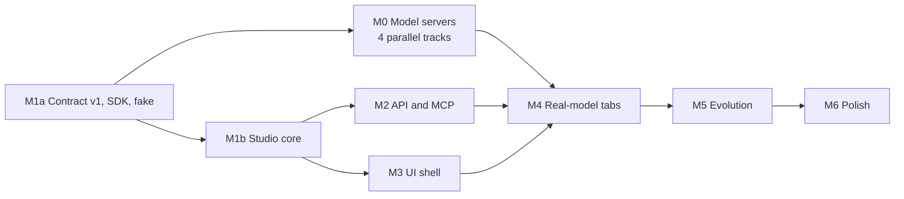

# Asset Studio — work plan

<!-- markdownlint-disable MD013 -->

Working plan based on [README.md](README.md). Records key decisions, first-version
scope, milestones with acceptance criteria and parallel-agent workflow.

## 1. Purpose

A local studio where people (web UI) and agents (REST/MCP) submit jobs to
generative models for images, 3D, Russian speech and sounds, storing results
in a shared asset library with provenance.

Models run as **independent local servers**, manually started by the user.
Studio does not manage them: it knows their addresses, displays availability
and submits jobs. X-to-X modalities have an **evolution mode**: three candidates
→ selection → next generation with mutations.

## 2. Decisions

| Question | Decision |
| --- | --- |
| Purpose | Hobby: Studio is not published and games are not sold. Non-commercial model licenses are acceptable. |
| Speech language | Mainly Russian. |
| Access | This laptop only: everything listens on `127.0.0.1`, without authentication. |
| Existing scripts (`games/platformer`, removed after TripoSR moved into Studio; `local_llm`) | Do not migrate code; write from scratch for clear goals. Reuse **knowledge**: local TripoSR, pinned torch/CUDA, CPU marching cubes to avoid building `torchmcubes`, Vulkan and llama.cpp behavior on this machine. |
| Model startup | Manual, separate servers. Studio only connects. |
| Evolution | X-to-X only in v1. LLM prompt mutations may come later as a separate feature. |
| Laptop resources | **Not Studio's responsibility.** No VRAM monitoring, server-count limits or hardware-centered features. Users decide which/how many servers stay loaded. |
| `asset_lab` | Unchanged; not migrated into Studio. |

## 3. Environment constraints

| Constraint | Consequence |
| --- | --- |
| RTX 3070 Laptop, 8 GB VRAM, 30 GB RAM | Affects M0 model selection only: servers must run here. Does not dictate Studio architecture/features. |
| Incompatible model dependencies | Each server has its own environment (`uv` + lockfile). Studio core has no torch dependency. |
| Checkout inside Dropbox | Weights, database and artifacts **outside Dropbox**, configurable paths defaulting to XDG directories. |
| Agent sandbox may hide GPU | Test Studio with a GPU-free **fake model server**; GPU checks are separate. |

## 4. First-version scope

**Included:** text-to-image/image-to-image, image-to-3D, text-to-3D as text →
image → 3D, Russian text-to-speech, text-to-audio (effects and short music),
asset library, queue, REST + MCP, image-to-image evolution (and audio-to-audio
if supported by M0's model).

**Excluded from v1:** model startup/shutdown from Studio, LLM tab/mutations,
authentication, cloud APIs, fine-tuning, rigging/animation, video, native
text-to-3D models.

## 5. Architecture

### 5.1 Components



- **Studio:** one FastAPI process for HTTP API, MCP, UI/files and a background
  **dispatcher** that sends SQLite-queued jobs to model servers. No separate
  worker process: Studio does not launch anything.
- **Model server:** an independent program/environment, started with `just serve`
  in its directory. Loads the model at startup, implements the shared HTTP
  contract (§5.2) and describes its capabilities.

Separation lets agents queue jobs before servers start. Jobs wait in “waiting
for model” and dispatch once the server is available.

### 5.2 Model server contract (essential)

Every server implements one small HTTP contract, so new models need no Studio
code changes. Reference: [ADR-001](docs/adr/0001-model-server-contract.md) and
`model_server_sdk/src/model_server_sdk/contract.py`. Overview:

- `GET /v1/info`: state (`loading | ready | busy | error`), model and tasks.
  Each task declares prompt requirements, role-based inputs, parameter JSON
  Schema, `max_count` and output types.
- `POST /v1/generate`: synchronous generation of `count` results; base64 files.
  Response includes model, effective parameters and each result's seed.
- Shared errors with `retryable`; concurrent requests receive `409 busy`.

The **model server SDK** (`model_server_sdk`) implements the entire contract.
Authors implement only `load()` and `generate(job)`; see
[model_server_sdk/README.md](model_server_sdk/README.md).
`python -m model_server_sdk.check URL` checks any server's compliance.

### 5.3 Servers and sections

> Since M8 (ADR-004), sections are automatic: config lists servers, sections
> follow result kinds (images, 3D, audio, text, video), and models are selected
> inside sections. The original M1 design follows.

Servers are configured, not hardcoded:

```toml
# ~/.config/assets-studio/studio.toml
[[servers]]
id = "image"
title = "SDXL"
url = "http://127.0.0.1:9101"

[[servers]]
id = "mesh"
url = "http://127.0.0.1:9102"
```

Tab UI comes from `/v1/info` tasks. Templates cover text-to-image, image-to-image,
image-to-3d, text-to-speech, text-to-audio and audio-to-audio. “Advanced” is
built from `params_schema`. Replacing a model requires only stopping its server
and starting another on the same port; the tab shows the new model/parameters.

Header indicators: grey unavailable (with startup-command hint), yellow
loading/busy, green ready, red error.

### 5.4 Storage and queue

Reference: [ADR-002](docs/adr/0002-storage-and-queue.md). Overview:

- SQLite (WAL, explicit SQL, numbered migrations) stores metadata/queue;
  content-addressed SHA-256 blobs store files. Data lives outside Dropbox.
- Jobs store `/v1/generate` model snapshots and effective parameters. Models
  change manually; snapshots are the only way to identify what made a result.
- Queue: `queued → waiting_model → running → succeeded | failed | cancelled`.
  One running job per server address, waiting for `ready`. Dependencies build
  text-to-3D (image → 3D).
- Failed/interrupted jobs retry as new jobs, without rewriting history.

### 5.5 Evolution mode (X-to-X)

- **Image-to-image:** next-generation candidates derive from the selected
  image, each with a new seed. Mutation strength (weak/medium/strong) sets
  `strength`. Users may edit prompts before the next generation: directed
  mutation without an LLM.
- **Audio-to-audio:** same, if declared by the audio server (Stable Audio Open
  accepts initial audio; verified in M0d).
- One generation = one job with `count = 3`, one model call per generation.
- History is a tree; branch from any candidate of any generation.
- Text-to-X without evolution has **Variants**: N differently seeded results
  in one job.

Evolution is not tied to a tab; it is available wherever a server declares X-to-X.

### 5.6 API and MCP

REST (OpenAPI generates UI TypeScript types):

- `GET /api/servers`: model servers, live status and tasks (ADR-004).
- `POST /api/jobs`, `GET /api/jobs/{id}`, `GET /api/jobs?status=`, `POST /api/jobs/{id}/cancel`, `POST /api/jobs/{id}/retry`.
- `GET /api/events`: SSE job/server status.
- `GET /api/assets`, `POST /api/assets` (file or URL), `GET /api/assets/{id}/file`, `GET /api/assets/{id}/lineage`.
- `POST /api/evolutions`, `POST /api/evolutions/{id}/next`: candidate selection,
  mutation strength, prompt edits.

MCP mirrors workflows: `list_servers` (including available models), `generate`,
`wait_for_job` (timed long polling), `list_assets`, `get_asset` (including local
file path), `import_asset`, `start_evolution`, `next_generation`. Requests
support `idempotency_key`.

MCP runs within Studio (streamable HTTP), sharing one queue between UI and agents.

### 5.7 Interface

Inspired by Mixamo. Top bar: configured tabs and **Library**, availability per
tab, queue counter on the right. Every tab has the same layout:

- Narrow left column: prompt/input, 2–3 main parameters, collapsed Advanced,
  Generate, Variants and Evolution (X-to-X only).
- Large center preview: image, GLB `model-viewer`, audio waveform/player.
- Tab history strip below.

Image-to-X inputs: drag-and-drop, URL or library picker. Send any result to
another tab with a button (“→ 3D”).

Stack: Vite + TypeScript + Preact, no UI kit. Bundle `model-viewer` and
`wavesurfer.js`, without CDN.

### 5.8 Code layout

```text
assets_studio/
  README.md, PLAN.md, flake.nix, justfile
  docs/adr/                # contract v1, database schema, ...
  docs/models/             # M0 reports
  docs/reviews/            # critic review logs
  studio/                  # Studio Python package, no torch
    domain/                # entities and rules, no I/O
    storage/               # db.py, migrations/, blobs.py
    dispatch/              # queue, dispatcher, contract client, /v1/info polling
    services/              # generation, evolution, library; shared API/MCP entry
    api/  mcp/
  model_server_sdk/        # shared model-server package
  model_servers/
    fake/                  # deterministic test server, no GPU
    <name>/                # pyproject + uv.lock, server.py, justfile (serve, doctor)
  web/
  tests/
```

Dependency rules: `domain` depends on nothing; `api`/`mcp` depend only on
`services`; `studio`/`model_servers` communicate only through HTTP
(`model_server_sdk` contains contract Pydantic models, also imported by Studio).
CI checks rules with import-linter.

Tooling: Python 3.12+ for Studio, `ruff`, strict `pyright` for `studio/` and SDK,
`pytest`; `tsc`, `eslint` for `web/`. Own `flake.nix` based on `local_llm`.

## 6. Milestones



Fix contract/SDK first (M1a), so M0 servers use the contract from the outset
rather than disposable PoCs. M0 findings may change the contract until M4 closes.

### M1a. Contract v1, SDK, fake server (sequential, first)

- ADR-001: model-server contract (§5.2).
- ADR-002: database/queue schema (§5.4).
- `model_server_sdk`; `model_servers/fake`: all task types, deterministic
  images/GLB/WAV, simulated delays, `busy` and errors.

**Acceptance:** fake-server contract tests pass; ADRs reviewed by critic.

### M0. Model servers (four parallel tracks)

Each track's agent finds Hugging Face candidates, tests the best 2–3, packages
the winner on the SDK, and writes `docs/models/<track>.md`: each candidate's
license, revision, peak VRAM (informational), load/generation time, 3–5 outputs
and conclusion.

Initial candidates need rechecking: this list reflects mid-2026 knowledge.

| Track | Candidates | Evaluation |
| --- | --- | --- |
| M0a text-to-image + image-to-image | FLUX.1-schnell/dev NF4 or GGUF; SDXL family; SD 3.5 Medium | Can FLUX fit 8 GB without painful offload? img2img quality underpins evolution |
| M0b image-to-3D | TripoSR (known-working baseline); Stable Fast 3D; Hunyuan3D-2mini; TRELLIS | Hunyuan3D excludes EU use; user decides. TRELLIS likely exceeds 8 GB |
| M0c Russian text-to-speech | Silero TTS; XTTS-v2 voice cloning; Russian F5-TTS fine-tunes; Fish Speech/OpenAudio; Piper CPU | Natural Russian, stress, voice cloning, CPU operation |
| M0d text-to-audio + audio-to-audio | Stable Audio Open 1.0/Small; AudioLDM 2; MusicGen | SFX quality, duration, initial-audio generation for evolution |

Status 2026-09-30: M0a SDXL/FLUX.1-schnell Q8; M0b TripoSR; M0c XTTS-v2;
M0d Stable Audio Open 1.0 (music up to 47 seconds). Tabs are model-named.

**Track acceptance:** report; winning server passes `just doctor` (device
visibility, model load) and contract smoke test on this machine.

### M1b. Studio core (parallel with M0)

Storage, migrations, blobs, tab config, `/v1/info` polling, dispatcher (one job
per tab, `waiting_model`, `depends_on`, idempotency, interrupted-job marking),
generation/library services.

**Acceptance:** fake-server integration tests: wait for unstarted server, then
run after startup; crash during job → `failed (connection_lost)`, retry creates
a new job; `busy` does not consume retries; two-server dependency chain;
idempotency; URL import with size/MIME limits.

### M2. API + MCP (after M1b, parallel with M3)

REST, SSE, OpenAPI, generated TS types, in-process MCP.

**Acceptance:** MCP end-to-end: discover tabs, submit fake job, wait, get file
path; same scenario through REST.

### M3. UI shell (after M1b, parallel with M2, using OpenAPI mocks)

Configured top bar/indicators, task templates, JSON Schema forms, library
(filters, favorites, lineage), image/GLB/audio viewers, history strip,
result transfer between tabs.

**Acceptance:** every template works with fake server; indicators follow server
stop/start; 1280 px without horizontal scrolling; critic screenshot UI review.

### M4. Real-model tabs (parallel by modality)

Connect M0 servers, default tab config, adapt templates to real parameters.
The 3D tab's “From text” creates text-to-image → image-to-3D.

Deferred from M3 review: server tasks (`last_seen`) are memory-only; persist
forms across restarts (for example in database) when Studio starts before servers.

**Acceptance:** each real-GPU tab passes start server → green indicator → input
→ library result → download; cross-tab result transfer; replacing server on
the same port updates model without restarting Studio.

### M5. Evolution mode

Evolution service (§5.5); UI with three candidate cards, selection, mutation
strength, prompt edits, branching generation tree. MCP: `start_evolution`,
`next_generation`.

**Acceptance:** five consecutive image-to-image generations; branch from an
older candidate; generation time in report; audio-to-audio if confirmed by M0d.

### M6. Polish

Edit tabs in UI (write config), unavailable-server startup hints, unused-blob
cleanup, database backup, one `just studio` startup command.

### M7. New modalities (added 2026-09-30)

User request after M0a–M0d. Each track follows M0: candidates, report at
`docs/models/<track>.md`, SDK-based winner, contract check, critic review.
Quality over speed.

**First: ADR 0003 “Contract v1.1”** (backward-compatible extension, completed
2026-10-01, `docs/adr/0003-contract-text-video.md`):

- Tasks `text-to-text`, `image-to-video`, `text-to-3d`.
- Canonical `text/plain` UTF-8 and `video/mp4` H.264, signatures in SDK/fake server.
- UI: copyable text preview/video player; X-to-X `text-to-text` supports evolution.
- Primary task parameters (duration, strength) marked in schema and shown
  immediately, outside Advanced.
- Audio import with WAV transcoding (FLAC, OGG, MP3); Studio currently accepts
  only WAV.

| Track | Candidates | Evaluation |
| --- | --- | --- |
| M7a text-to-text (LLM), done: Gemma 4 12B, Qwen3.8 27B | Qwen3 8B/14B; Gemma 3 12B; Mistral Small 3.x GGUF through llama.cpp, some layers on GPU/rest RAM | Russian quality, tokens/s with 8 GB VRAM/~18 GB RAM, context, seeded determinism |
| M7b first-frame image-to-video, done: Wan2.2 TI2V-5B (720p × 5 s ≈ 1 h) | FramePack (6 GB target); Wan 2.2 TI2V-5B; Wan 2.1 I2V-14B GGUF group offload like FLUX; LTX-Video | Motion/first-frame fidelity, duration/fps; minutes per clip acceptable |
| M7c text-to-3D | FLUX → TripoSR via existing `depends_on`; native Hunyuan3D-2 (t2i + shape), TRELLIS text | Separate model versus two-tab chain; user decides on Hunyuan3D EU license |

M7c starts with the chain: no new model, immediate baseline for native candidates.

### M8. User suggestions (2026-10-01)

1. **Done (ADR-004): asset deletion** from library/tab history. Remove from
   library, delete file when no job/provenance reference remains. Together
   with M6 unused-blob cleanup.
2. **Done (ADR-005): EN/RU localization.** `web/src/i18n.ts`, top-bar switch,
   browser-language default; English parameter `description`, Russian `x-labels`
   (`ui(ru=...)` in SDK).
3. **Done (ADR-004): task-type tabs with model selection inside** (Images:
   SDXL/FLUX; Text: Gemma/Qwen). Config changes tab → server list; jobs store
   server rather than only tab (database migration); simpler send-to. Needs ADR.
4. **Done: dark theme.** Second CSS-variable palette, `prefers-color-scheme`,
   remembered system/light/dark switch.
5. **Done: actual-size images.** Preview opens Fit / 100% / 200% on transparency
   checkerboard; 100% maps image pixels to screen pixels.
6. **Zuul CI:** done; verify when cluster returns. Job `assets-studio-check`
   (`zuul.d/checks.yaml`, `production/playbooks/assets-studio-check.yaml`):
   `just assets_studio check` covers Studio, SDK, fake server, UI build/lint.
   Build node adds only `uv`, `just`, `python311`; without Chrome/ffmpeg,
   browser/media tests skip. CUDA model servers are not checked in CI; run
   their `just test` locally. Locally reproduced with Python 3.14 without
   interpreter downloads and Nix 3.11: all green. Also ruff for `assets_studio/`
   in pre-commit (`pre-submit-check`).

### Deferred SDK technical debt (decision 2026-10-01)

Revisit after M7 models and main plan M4–M6:

- Mid-generation progress/cancellation (contract v2): LLM takes minutes,
  video longer; Cancel currently removes queued jobs only.
- SDK lifecycle: `close()` on shutdown, post-load transition to `error`, explicit
  guarantee of one model thread throughout process lifetime (LLM PDEATHSIG
  depends on it).
- Video import conversion occurs inside requests, up to ten minutes without
  progress indication.
- Check system `ffmpeg` at startup; format detection rules split between SDK
  and Studio.

## 7. Agent workflow

- Each milestone (and M0/M4 track) uses a separate branch/worktree. Agents
  stay within their layout area (§5.8); contract/schema changes require ADRs.
- **Critic review:** a separate critic sub-agent receives diff, acceptance
  criteria and active ADRs after each stage. It returns blockers/recommendations.
  Proposal → critique → fix cycle: **at most five iterations**. Remaining
  blockers after five go to the user. Log: `docs/reviews/<milestone>.md`.
- Critic checks acceptance, dependency rules, no workarounds (hardcoded paths/
  models, suppressed errors, sleeps instead of synchronization), behavior tests
  and up-to-date documentation.
- Run GPU checks only if `doctor` detects the device; otherwise explicitly
  report unverified GPU behavior.

## 8. Risks

| Risk | Mitigation |
| --- | --- |
| Best models do not run on this laptop | Quantization, offload, M0 measurements; model-server choice, not Studio design |
| Open-model Russian speech quality | Dedicated listening track M0c; allow multiple speech servers |
| Manual model replacement harms reproducibility | Per-job `model_snapshot` |
| No mid-generation cancellation | Deliberate v1 limit; contract v2 if needed |
| GB of weights synced through Dropbox | Data/cache default outside checkout |
