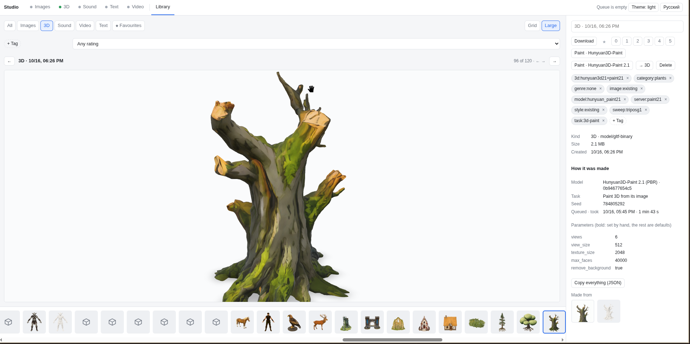
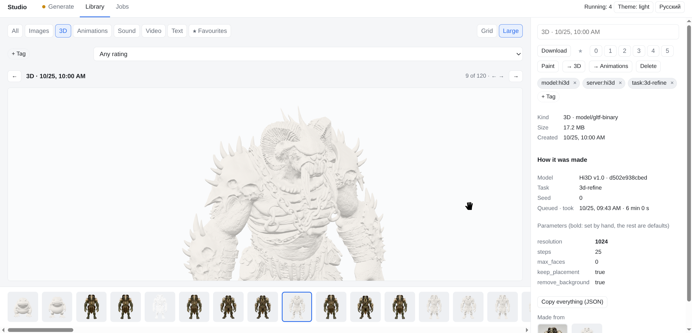

# Asset studio

A local studio for making game assets with generative models: images, 3D
models, speech, sounds and music, text and short videos. People use it
through a web UI, agents through a REST API and MCP.

Each model runs as its own server, started when needed.

<!-- markdownlint-disable MD013 MD033 -->
<p>
  <a href="../static/assets_studio/screenshot-2026-10-18-20-03-00.png"></a>
  <a href="../static/assets_studio/screenshot-2026-10-18-20-03-13.png"></a>
  <a href="../static/assets_studio/screenshot-2026-10-25-12-38-27.png"></a>
  <a href="../static/assets_studio/screenshot-2026-10-25-12-38-47.png"></a>
</p>
<!-- markdownlint-enable MD013 MD033 -->

## Layout

| Path | What |
| --- | --- |
| `studio/` | The studio: job queue, library (SQLite + files), API, MCP |
| `web/` | The web UI (Preact) |
| `model_server_sdk/` | SDK and contract checker for model servers |
| `asset_processing/` | Shared Blender conversion, rig preparation and motion transfer, independent of the SDK |
| `model_servers/` | One server per model, each with its own environment |
| `docs/adr/` | Design decisions: the model-server contract, storage, sections |
| `docs/models/` | Why each model was chosen, with measurements |
| `docs/guides/` | How to make game assets: 3D, characters, engine, audio |

## Quick start

```sh
just sync && just web-install && just web-build
mkdir -p ~/.config/assets-studio
cp studio.example.toml ~/.config/assets-studio/studio.toml
just studio                     # http://127.0.0.1:9000
```

Then start the models you need, each in its own terminal:

```sh
cd model_servers
just setup qwen_image                 # once per server: its environment
just qwen_image                 # or: hunyuan3d21, xtts,
                                #     stable_audio, gemma, qwen, wan, fake
```

## Inspecting a mesh

Open a GLB in the library and use the controls below the 3D preview:
**Material**, **Geometry** (matte clay without textures or normal maps), or
**Wireframe**. The wireframe can also show the original material with the
**Texture** checkbox. Switching views preserves the camera and the downloaded
asset. Counts show triangles and vertices, including vertices split at UV seams;
quads exported to GLB appear as triangles.

## Models

| Server | Task | Notes |
| --- | --- | --- |
| `birefnet` | image → image | BiRefNet: background removal (MIT), a few seconds |
| `sam2` | video + isolated first frame → video | SAM 2.1: track one subject on white, original video pixels; [use](model_servers/sam2/README.md) |
| `hunyuan3d21` | image → 3D | Hunyuan3D-2.1 Shape (3.3B), offloaded to RAM; on trial |
| `hi3d` | 3D + image → 3D | Hi3D v1.0: a coarse mesh refined from its image, 512³–1536³ grid; geometry only; [setup](model_servers/hi3d/README.md); on trial |
| `trellis2_paint` | 3D + image → 3D | TRELLIS.2 Paint: PBR on an existing mesh, preserves its surface; 512 material grid; [setup](model_servers/trellis2_paint/README.md) |
| `hunyuan_paint21` | 3D + image → 3D | Hunyuan3D-Paint 2.1: PBR (base colour, metallic, roughness), offloaded; on trial |
| `mia` | 3D → rig | Make-It-Animatable v2: Mixamo skeleton, skin weights; FBX |
| `skintokens`, `unirig` | 3D → rig | any skeleton (animals, birds, props), skin weights; FBX; on trial |
| `animation_tools` | rig + animation → animated character | Blender: prepare rigs, transfer Kimodo/Mixamo motion; [use](model_servers/animation_tools/README.md) |
| `mocapanything` | video + rig → animation | MoCapAnything V2: a quadruped rig (SkinTokens) moving as in the video; FBX |
| `prompthmr` | video + selected-track observations → native motion | PromptHMR-video research pilot; [setup and limits](model_servers/prompthmr/README.md) |
| `gvhmr` | video + humanoid rig → animation | GVHMR: human motion, Mixamo rig; FBX; [setup](model_servers/gvhmr/README.md) |
| `kimodo` | text → animation | Kimodo: humanoid motion, FBX with Mixamo bone names (Unity Humanoid) |
| `xtts` | text → speech | 14 languages, voice cloning |
| `stable_audio` | text → sound, sound → sound | effects and music up to 47 s |
| `gemma`, `qwen` | text → text | Gemma 4 12B, Qwen3.8 27B via llama.cpp |
| `wan` | image → video | Wan2.2 TI2V-5B, 720p × 5 s ≈ 1 hour |

Adding a model means writing a server on `model_server_sdk` and adding it
to the config; the studio needs no changes. Check a server with
`just check-server http://127.0.0.1:<port>`.

## Development

```sh
just check      # lint, types, tests, web UI build and lint (no GPU)
cd model_servers && just test   # each server's own tests (no GPU)
```

Saved job graphs: [`studio flow`](flow/README.md), a separate editor on
`http://127.0.0.1:9001` (`just flow`). Studio owns the queue and library;
launcher starts models; flow saves and submits repeatable chains.

Plan and status: [`PLAN.md`](PLAN.md).

Agent visual inspection uses local Qwen3.8 image/video-to-text tasks; see
[shared media rules](../.agents/media-analysis.md) and
[the mocap approach review](docs/reviews/mocap-approach.md).
Hunyuan3D-2mini and Paint 2.0 are retired from the active catalog; use 2.1.
