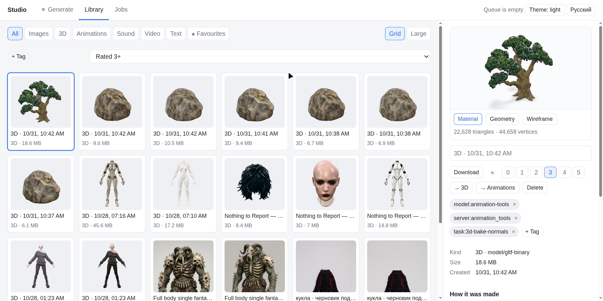
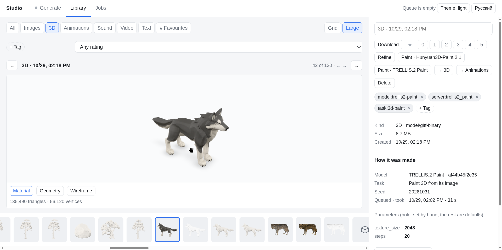
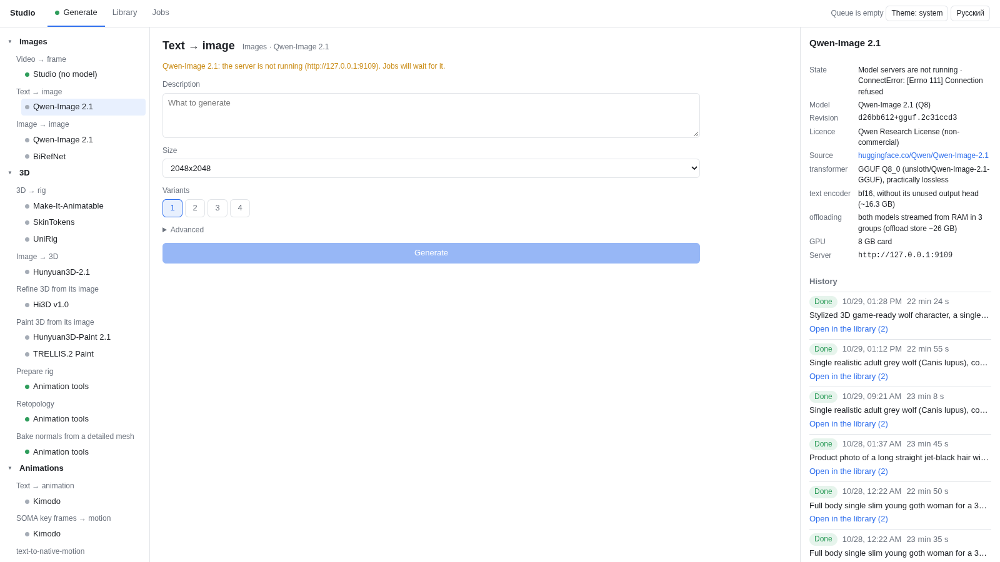
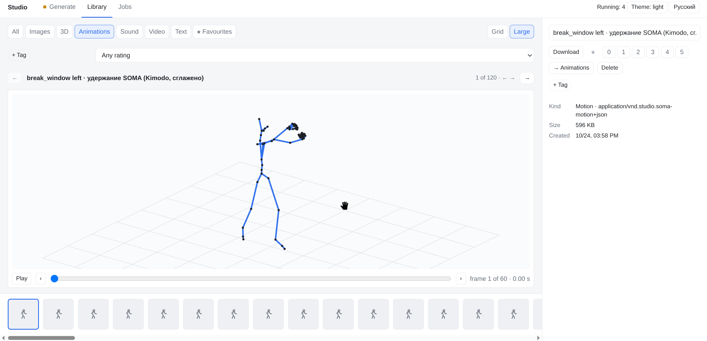
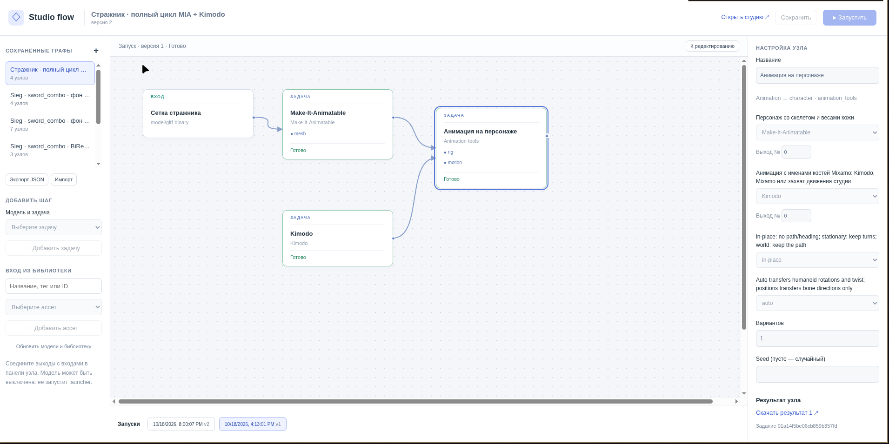

# Asset studio

A local studio for making game assets with open generative models on one
8 GB GPU: images, 3D models with PBR textures, rigs and animation, speech,
sound effects, songs, text and short videos. People use it through a web
UI, agents through a REST API and MCP.

<!-- markdownlint-disable MD013 MD033 -->
<p>
  <a href="../static/assets_studio/screenshot-2026-10-31-11-03-02.png"></a>
  <a href="../static/assets_studio/screenshot-2026-10-31-11-02-02.png"></a>
  <a href="../static/assets_studio/generate.png"></a>
  <a href="../static/assets_studio/screenshot-2026-10-25-12-38-27.png"></a>
  <a href="../static/assets_studio/screenshot-2026-10-18-20-03-00.png"></a>
</p>
<!-- markdownlint-enable MD013 MD033 -->

Every model runs as its own server, in its own environment, behind a
common HTTP contract ([ADR 0001](docs/adr/0001-model-server-contract.md)).
The studio never loads a model: it queues jobs, passes one job's output to
the next, and keeps every result with its model revision, seed, parameters
and inputs. The launcher starts the server that a ready job needs, one GPU
model at a time, and stops it when it has nothing left to do.

## Layout

| Path | What |
| --- | --- |
| `studio/` | The studio: job queue, library (SQLite + files), REST API, MCP |
| `web/` | The web UI (Preact) |
| `launcher/` | Starts and stops model servers for the queued jobs |
| `flow/` | A separate editor for saved, repeatable job graphs |
| `model_server_sdk/` | SDK and contract checker for model servers |
| `model_servers/` | One server per model, each with its own environment |
| `asset_processing/` | Shared Blender steps: conversion, rig preparation, motion transfer, retopology, normal baking |
| `agent_tools/` | `describe_media.py`: an agent asks the studio's vision model about an image or video and reads text |
| `docs/adr/` | Design decisions: the contract, storage, sections, ratings, flow, projects, mesh thumbnails |
| `docs/models/` | Why the models were chosen, with measurements |
| `docs/guides/` | How to make game assets: 3D, characters, quadrupeds, engine, audio |

## Requirements

- Linux on x86-64 with an NVIDIA GPU. The models were chosen and measured on
  an 8 GB RTX 3070 Laptop GPU with 30 GB of RAM; several of them keep their
  weights in RAM and move them to the GPU step by step.
- [uv](https://docs.astral.sh/uv/) and [just](https://just.systems/). The
  studio needs Python 3.12 or newer, model servers bring their own (uv
  downloads what is missing).
- Node.js 20.19+ or 22.12+ to build the web UI.
- ffmpeg, for video.
- Blender (tested with 5.1) on `PATH` or in `BLENDER`, for rigs, motion
  transfer and mesh processing.
- [Nix](https://nixos.org/) with flakes, unless you replace the GPU shells
  (below).

Each server's README lists its own needs: weights and disk space, Hugging Face
access to gated models (`HF_TOKEN`), native modules.

## Quick start

```sh
just sync && just web-install && just web-build
mkdir -p ~/.config/assets-studio
cp studio.example.toml ~/.config/assets-studio/studio.toml
just studio      # http://127.0.0.1:9000
just launcher    # in another terminal: runs model servers for queued jobs
```

Set up each model server once (its environment and weights; see its
README):

```sh
cd model_servers
just setup qwen_image   # the server's directory in model_servers/
just doctor qwen_image  # what it sees: PyTorch, the GPU, the weights
```

When a job is ready, the launcher starts its server with a `model_servers/`
recipe (`just qwen_image` there), one GPU model at a time; a server can also
be started by hand the same way. The launcher is a stand-in outside the
studio: its `RECIPES` table in `launcher/launcher.py` maps the server ids of
`studio.example.toml` to their recipes, and it leaves other servers alone, so
a server may run elsewhere.

## Configuration

`studio.example.toml` lists every server with its address and documents the
other settings. The studio reads `~/.config/assets-studio/studio.toml`, or
the file given with `--config`.
The library (database and files) is in `~/.local/share/assets-studio`; model
environments, sources and weights are in `~/.cache/assets-studio`
(`XDG_DATA_HOME` and `XDG_CACHE_HOME` move them).

### GPU shells

A model server's commands (`setup`, `serve`, `test`…) run in a dev shell of
the repository's `flake.nix`: `assets-studio-gpu` provides Python 3.11, uv and
the C++ runtime, and adds the NVIDIA driver from `/run/opengl-driver/lib`
(NixOS) or `/usr/lib64`; `assets-studio-cuda` adds the CUDA toolkit for the
servers that build native extensions. Without Nix, or when the driver is
elsewhere (as on Debian and Ubuntu), replace them
([`model_servers/common.just`](model_servers/common.just)):

```sh
export ASSETS_STUDIO_GPU_SHELL=""   # run the commands as they are
export ASSETS_STUDIO_CUDA_SHELL=""  # needs nvcc, CUDA_HOME and CXX
export TORCH_CUDA_ARCH_LIST=8.9     # GPU of native modules (default 8.6)
```

A non-empty value is a command prefix, such as a wrapper script that sets up
the environment. Set them before `just setup`: an environment made in the Nix
shell uses its Python and C++ runtime and does not run without it.
`TORCH_CUDA_ARCH_LIST` is the GPU architecture that native modules are built
for: `nvidia-smi --query-gpu=compute_cap --format=csv`.

## Models

| Section | Server | Model | Does |
| --- | --- | --- | --- |
| Images | `qwen_image` | Qwen-Image 2.1 | Text → image, image editing |
| | `birefnet` | BiRefNet | Background removal for images and videos |
| 3D | `hunyuan3d21` | Hunyuan3D-2.1 Shape | Image → coarse mesh |
| | `hi3d` | Hi3D v1.0 | Coarse mesh + its image → detailed surface; [setup](model_servers/hi3d/README.md) |
| | `trellis2_paint` | TRELLIS.2 Paint | PBR paint of an existing mesh, its surface kept; [setup](model_servers/trellis2_paint/README.md) |
| | `paint21` | Hunyuan3D-Paint 2.1 | PBR paint from the source image |
| | `hairdeck` | HairDeck | Character image → hair cards (game-style strips, coloured); [setup](model_servers/hairdeck/README.md) |
| | `rig`, `skintokens`, `unirig` | Make-It-Animatable, SkinTokens, UniRig | Mesh → skeleton and skin weights (Mixamo or any shape) |
| | `animation_tools` | Blender | Rig preparation, motion transfer, retopology, normal baking; [use](model_servers/animation_tools/README.md) |
| Animation | `motion` | Kimodo | Text or key frames → humanoid motion |
| | `motion_smplx` | Kimodo SMPL-X | Native SMPL-X motion and in-betweens |
| | `gvhmr`, `gemx` | GVHMR, GEM-X | Human motion from video; [GVHMR setup](model_servers/gvhmr/README.md) |
| | `mocapanything` | MoCapAnything V2 | A quadruped rig moving as in a video |
| | `htd_refine`, `prompthmr` | HTD-Refine, PromptHMR | Refining native motion from video (research) |
| | `vitpose` | ViTPose++ | The 2D joints of a character in a video, drawn ones too; [use](model_servers/vitpose/README.md) |
| Video | `sam2` | SAM 2.1 | One subject of a video on white; [use](model_servers/sam2/README.md) |
| Sound | `voice` | XTTS-v2 | Speech in 14 languages, voice cloning |
| | `sound` | Stable Audio Open | Sound effects and music up to 47 s |
| | `song` | YuE2 | Songs with vocals from lyrics |
| Text | `gemma`, `qwen` | Gemma 4 12B, Qwen3.8 27B | Text; Qwen also describes images and videos |
| | `unlimited_ocr` | Unlimited-OCR 2 | Document page image → text; [setup](model_servers/unlimited_ocr/README.md) |

`model_servers/` also keeps five retired servers: `flux` (FLUX.1-schnell),
`hunyuan3d` (Hunyuan3D-2mini), `hunyuan_paint` (Hunyuan3D-Paint 2.0),
`triposg` (TripoSG) and `wan` (Wan2.2 TI2V-5B). The servers above replaced
the first four. `wan` made video from a first frame, but a five-second 720p
clip took about an hour on an 8 GB GPU, so the studio no longer generates
video; video still comes in by import. The retired servers' code stays as a
starting point and is not maintained. Bringing one back follows steps 2–4 of
[Adding a model](#adding-a-model).

Licences differ per model: several are non-commercial, and some exclude
territories (Hunyuan3D 2.1 is not licensed in the EU, the UK and South
Korea). Each server reports its licence, and the UI shows it on the model's
card.

## Adding a model

A model is a server on `model_server_sdk`, in its own project and
environment; the studio needs no changes, it learns the tasks, parameters
and licence from the server ([SDK README](model_server_sdk/README.md)).

1. Start from a similar server in `model_servers/`. Its justfile imports
   `../common.just` and has `setup`, `serve`, `doctor` and `test` recipes.
2. Add a recipe that starts it to `model_servers/justfile`, and its directory
   to the `servers` list there (`just setup`, `doctor` and `test` without a
   name go through the list).
3. Add a `[[servers]]` entry to your config and to `studio.example.toml`, and
   its id with that recipe to `RECIPES` in `launcher/launcher.py`; then
   restart the studio and the launcher.
4. Check the contract: `just check-server http://127.0.0.1:<port>`.

`just fake-server` starts a GPU-free server with every task on port 9100;
add it to the config to try the studio without models.

## Projects

Every asset and job belongs to a project; what existed before projects is in
**Default**. The top bar picks the open project: the library, the history and
the sections show it, and new jobs and uploads go there. The queue is shared.
Inputs can come from any project, and an asset moves to another project from
its details. Agents pass `project` to the API and MCP; without it, everything
goes to `default` ([ADR 0010](docs/adr/0010-projects.md)).

## Inspecting a mesh

Open a GLB in the library and switch the preview between **Material**,
**Geometry** (matte clay without textures or normal maps) and
**Wireframe**; the wireframe can keep the material with **Texture**. The
camera stays where it was. Counts show triangles and vertices, including
vertices split at UV seams; quads exported to GLB appear as triangles.

In the library list a mesh is a still picture, drawn by the browser the first
time its thumbnail is shown and kept by the studio; FBX shows a cube
([ADR 0011](docs/adr/0011-mesh-previews.md)).

## Security

The studio is a single-user tool for one machine. It listens on 127.0.0.1
without authentication, so any local process can use it, and it accepts only
local `Host` names, so web pages cannot reach it through DNS rebinding; flow
does the same. Do not expose either on a network: MCP `import_asset` copies
any local file the studio can read into the library, URL imports download what
they are given, and model servers run the code of upstream projects.

## Development

```sh
just check                     # lint, types, tests, web UI (no GPU)
cd model_servers && just test  # each server's own tests (no GPU)
```

The lint step includes import-linter: the studio's layers (API and MCP, core,
services, dispatch, storage, domain) import only the layers below them, and
the contracts are in `pyproject.toml`. The studio takes the contract and its
media formats from `model_server_sdk` and reaches the model servers only over
HTTP.

## License

The code is under the GNU General Public License v3, the repository's
`LICENSE`. Models and their weights are not covered by it: each has its own
licence (see [Models](#models)).
