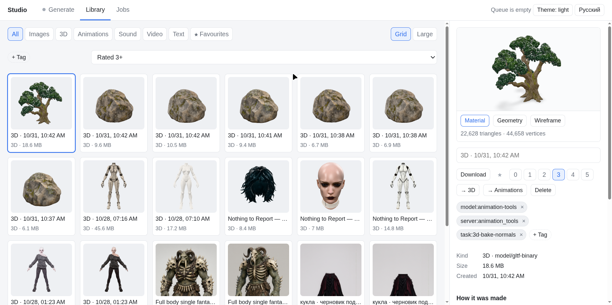
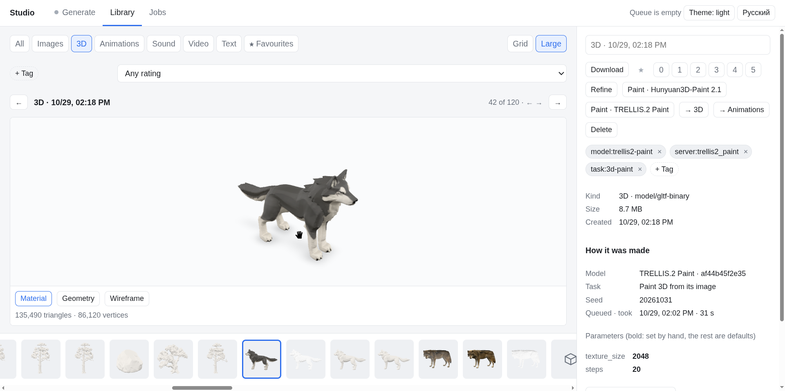
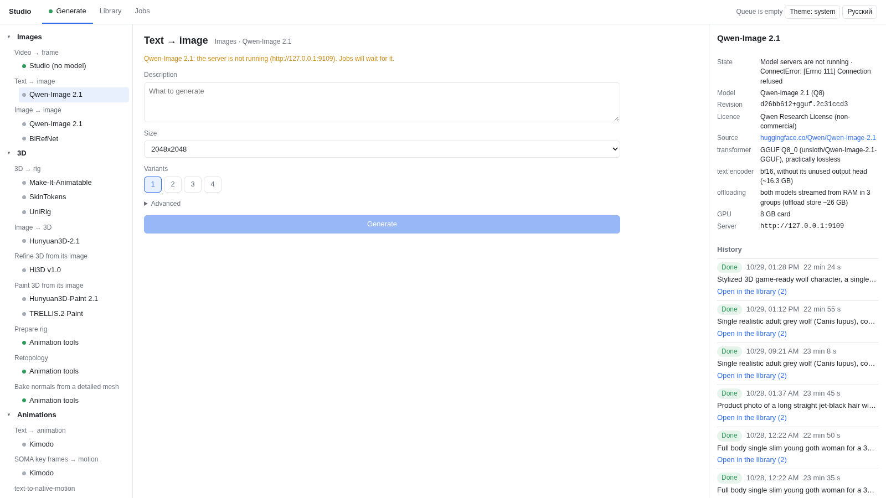
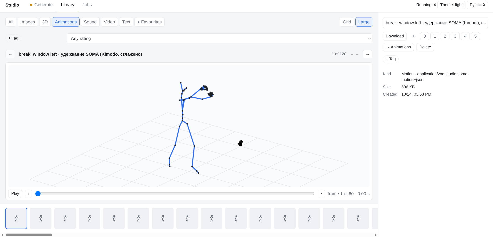
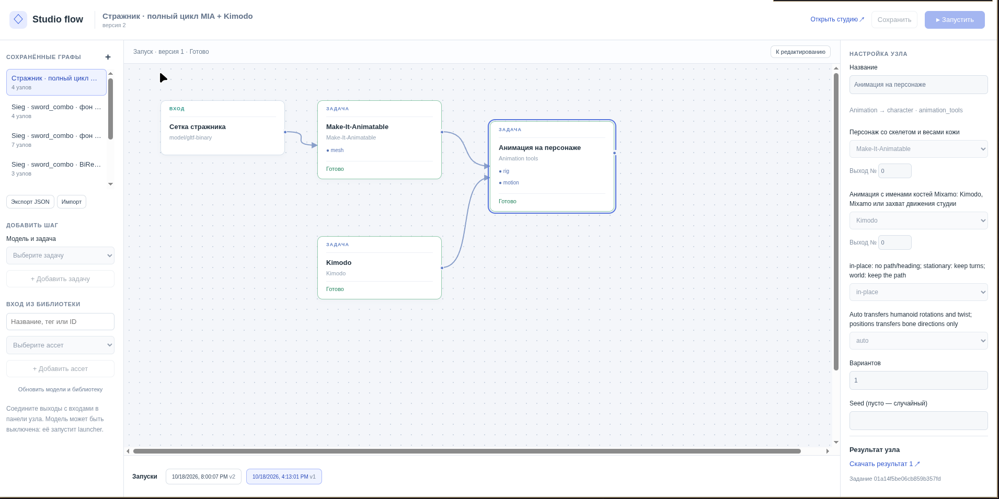

# Asset studio

A local studio for making game assets with open generative models on one
8 GB GPU: images, 3D models with PBR textures, rigs and animation, speech,
sound effects, songs, text and short videos. People use it through a web
UI, agents through a REST API and MCP.

<!-- markdownlint-disable MD013 MD033 -->
<p>
  <a href="../static/assets_studio/screenshot-2026-10-31-11-03-02.png"></a>
  <a href="../static/assets_studio/screenshot-2026-10-31-11-02-02.png"></a>
  <a href="../static/assets_studio/generate.png"></a>
  <a href="../static/assets_studio/screenshot-2026-10-25-12-38-27.png"></a>
  <a href="../static/assets_studio/screenshot-2026-10-18-20-03-00.png"></a>
</p>
<!-- markdownlint-enable MD013 MD033 -->

Every model runs as its own server, in its own environment, behind a
common HTTP contract ([ADR 0001](docs/adr/0001-model-server-contract.md)).
The studio never loads a model: it queues jobs, passes one job's output to
the next, and keeps every result with its model revision, seed, parameters
and inputs. The launcher starts the server that a ready job needs, one GPU
model at a time, and stops it when it has nothing left to do.

## Layout

| Path | What |
| --- | --- |
| `studio/` | The studio: job queue, library (SQLite + files), REST API, MCP |
| `web/` | The web UI (Preact) |
| `launcher/` | Starts and stops model servers for the queued jobs |
| `flow/` | A separate editor for saved, repeatable job graphs |
| `model_server_sdk/` | SDK and contract checker for model servers |
| `model_servers/` | One server per model, each with its own environment |
| `asset_processing/` | Shared Blender steps: conversion, rig preparation, motion transfer, retopology, normal baking |
| `sweep/` | Parameter sweeps over a model, with a gallery of the variants |
| `docs/adr/` | Design decisions: the contract, storage, sections, ratings, flow |
| `docs/models/` | Why each model was chosen, with measurements |
| `docs/guides/` | How to make game assets: 3D, characters, quadrupeds, engine, audio |

## Quick start

```sh
just sync && just web-install && just web-build
mkdir -p ~/.config/assets-studio
cp studio.example.toml ~/.config/assets-studio/studio.toml
just studio      # http://127.0.0.1:9000
just launcher    # in another terminal: runs model servers for queued jobs
```

Set up each model server once (its environment and weights; see its
README):

```sh
cd model_servers
just setup qwen_image
```

The launcher runs `just <server>` from `model_servers/` when a job for that
server is ready; a server can also be started by hand the same way.

## Models

| Section | Server | Model | Does |
| --- | --- | --- | --- |
| Images | `qwen_image` | Qwen-Image 2.1 | Text → image, image editing |
| | `birefnet` | BiRefNet | Background removal for images and videos |
| 3D | `hunyuan3d21` | Hunyuan3D-2.1 Shape | Image → coarse mesh |
| | `hi3d` | Hi3D v1.0 | Coarse mesh + its image → detailed surface; [setup](model_servers/hi3d/README.md) |
| | `trellis2_paint` | TRELLIS.2 Paint | PBR paint of an existing mesh, its surface kept; [setup](model_servers/trellis2_paint/README.md) |
| | `paint21` | Hunyuan3D-Paint 2.1 | PBR paint from the source image |
| | `rig`, `skintokens`, `unirig` | Make-It-Animatable, SkinTokens, UniRig | Mesh → skeleton and skin weights (Mixamo or any shape) |
| | `animation_tools` | Blender | Rig preparation, motion transfer, retopology, normal baking; [use](model_servers/animation_tools/README.md) |
| Animation | `motion` | Kimodo | Text or key frames → humanoid motion |
| | `motion_smplx` | Kimodo SMPL-X | Native SMPL-X motion and in-betweens |
| | `gvhmr`, `gemx` | GVHMR, GEM-X | Human motion from video; [GVHMR setup](model_servers/gvhmr/README.md) |
| | `mocapanything` | MoCapAnything V2 | A quadruped rig moving as in a video |
| | `htd_refine`, `prompthmr` | HTD-Refine, PromptHMR | Refining native motion from video (research) |
| Video | `video` | Wan2.2 TI2V-5B | Image → 5 s video |
| | `sam2` | SAM 2.1 | One subject of a video on white; [use](model_servers/sam2/README.md) |
| Sound | `voice` | XTTS-v2 | Speech in 14 languages, voice cloning |
| | `sound` | Stable Audio Open | Sound effects and music up to 47 s |
| | `song` | YuE2 | Songs with vocals from lyrics |
| Text | `gemma`, `qwen` | Gemma 4 12B, Qwen3.8 27B | Text; Qwen also describes images and videos |

Licences differ per model and several are non-commercial; each server
reports its licence, and the UI shows it on the model's card.

A new model is a server on `model_server_sdk` plus an entry in the config;
the studio needs no changes. Check a server with
`just check-server http://127.0.0.1:<port>`.

## Inspecting a mesh

Open a GLB in the library and switch the preview between **Material**,
**Geometry** (matte clay without textures or normal maps) and
**Wireframe**; the wireframe can keep the material with **Texture**. The
camera stays where it was. Counts show triangles and vertices, including
vertices split at UV seams; quads exported to GLB appear as triangles.

## Development

```sh
just check                     # lint, types, tests, web UI (no GPU)
cd model_servers && just test  # each server's own tests (no GPU)
```

Saved job graphs: [`flow`](flow/README.md), on `http://127.0.0.1:9001`
(`just flow`). The original plan and milestones: [`PLAN.md`](PLAN.md).
