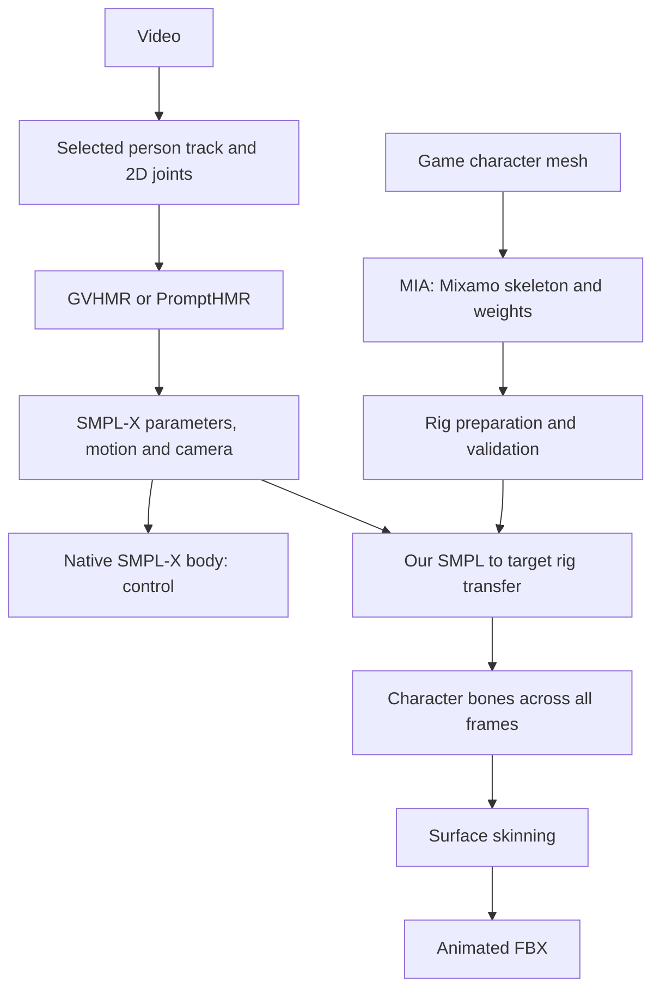

# How a character receives motion

Studio uses “model” in different senses: a character's geometric model and a
neural network that predicts something. SMPL-X is another kind: a parametric
human body description with coordinated geometry, skeleton and deformations.
Keeping these meanings separate is useful.

## Surface, skeleton and binding

A **mesh** is a surface of vertices connected by triangles. Textures provide
surface color but do not make it move. Armor and clothes may be separate
meshes following one skeleton.

A **joint** is a point around which a body part rotates.

A Blender **bone** is a skeleton element with a head, tail and local axes.
Hierarchy defines parents: pelvis → spine → upper arm → forearm → hand.
Rotating an upper arm moves the entire child chain. The displayed bone stick
is only a visualization; its matrix, axes and joint position matter for animation.

A **rig** contains the skeleton and mesh binding. More advanced tools also
include controls, constraints and IK. Our MIA output is mainly a Mixamo
skeleton and skin weights, not a finished artist control rig.

**Skinning weights** are assigned per vertex. A vertex near an elbow might
follow the forearm 60% and upper arm 40%; weights normally sum to 1. Normalized
weights can still be anatomically wrong: a chest vertex bound to the arm
will move when the arm rises. These are not neural network weights.

**Skinning** computes a new surface from the skeleton and weights. Linear
blend skinning (LBS) mixes transformed vertex positions by bone influence.
Even correct LBS may lose volume under strong twisting.

The **rest pose** is the initial bone arrangement, such as T- or A-pose.
The **bind pose** is the configuration in which the mesh was bound to the
skeleton. Usually these agree; import/export must preserve inverse bind
matrices. An error can deform the body before any movement.

An **animation clip** is a sequence of bone transforms over time. Rotations
are usually relative to parents, while root translation defines travel.
120 frames at 30 fps is four seconds. FBX and GLB are containers; sharing
a format does not imply compatible skeletons.

## What SMPL-X does

SMPL-X builds a surface from body-shape parameters (`betas`), body/hand/face
poses, facial expression, global rotation and translation. The neutral body
used here has 10,475 vertices. Standard joints, weights and mesh already agree.
Besides ordinary skinning, it includes learned pose-dependent shape corrections:
identical Blender and SMPL-X bones need not produce identical surfaces without
them.

SMPL-X does not extract motion from video itself. GVHMR and PromptHMR estimate
body and camera parameters, which SMPL-X then interprets. An incorrect head
lean may already exist in those parameters; the body model correctly displays
the incorrectly predicted pose.

Sources: [SMPL-X description](https://smpl-x.is.tue.mpg.de/),
[official implementation](https://github.com/vchoutas/smplx).

## Our two converging branches

MIA should not run on every frame: it rigs a static character once, after
which the rig can receive many clips. The pilot PromptHMR server currently
imports a track from saved GVHMR processing; automatic tracking of new uploads
is not yet integrated.

**Rig preparation** checks structure and weights and resets old animation.
It cannot automatically fix a wrongly predicted elbow.

**Retargeting** matches bones, aligns rest-pose directions, rotations and
proportions, then writes motion onto the target skeleton. Our SMPL profile
transfers 22 body joints. It does not cover all SMPL-X capabilities: full
fingers, face and weapon grip are not reconstructed. Identically named bones
may have different anatomical meanings; Mixamo's `Head` position need not
coincide with the SMPL-X joint.

**Coordinates and camera** independently cause discrepancies. Align up,
facing direction, meters/centimeters and body position relative to camera.
A changed viewpoint alone does not prove a pose error. To compare with video,
use the camera and camera-space pose, not an arbitrary side view of the
world-space body.

**Root motion** controls the root: `world` keeps travel; `stationary` removes
horizontal travel and retains turns; `in-place` also removes heading changes.
Vertical movement and lean remain.

**IK (inverse kinematics)** chooses bone rotations to reach an end-point
target, such as a foot on the floor or a hand on a grip. It differs from copying
rotations. Even good capture and rigs do not guarantee a two-handed sword grip
without corresponding constraints.

## Locating a problem

| Where the discrepancy appears | Check first |
| --- | --- |
| Already on the native body | Video, track, 2D joints, mocap model, camera |
| Native body correct, known control rig wrong | Axes, units, rest/bind pose, motion export, transfer |
| Known rig correct, automatic rig differs | MIA joint placement and weights, input geometry transforms |
| Bones look right, surface breaks | Skin weights, bind matrices, skinning method, missing correctives |
| Overall pose correct, feet slide or hands lose sword | Contacts, IK, weapon and limb constraints |

Frame-by-frame Qwen comparison is an additional observer: it can flag visible
differences but cannot measure hidden joints or prove an error's cause. Compare
its output with numerical bone and surface trajectories. The controlled
experiment is in `workspace/rigging_lab/`: simple geometry, native animation,
known weights and an MIA rig. Its graph is saved in Studio Flow; frame review
is in `index.html`.

A debugging example: the guard's ankle-to-toe bone is tilted about −46°, versus
SMPL-X's −25°. This reflects joint placement inside the boot, not an instruction
to rotate the sole by 21°. Previously transfer added about 23° of foot rotation
even at zero pose. The fix preserves neutral foot orientation and transfers
only predicted motion. A similar clavicle error added about 9 cm of shoulder
rise. These defects can be checked without video: at zero source pose, the
corresponding body parts should not gain rotations solely from shape differences.
