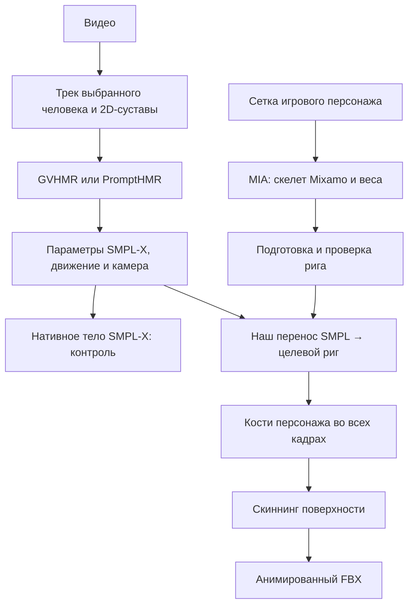

# Как персонаж получает движение

В студии встречаются два разных вида «модели»: геометрическая модель
персонажа и нейросеть, которая что-то предсказывает. SMPL-X — ещё один
вид модели: параметрическое описание человеческого тела с уже
согласованными геометрией, скелетом и деформациями. Эти понятия
полезно различать.

## Поверхность, скелет и привязка

**Mesh, или сетка** — поверхность из вершин, соединённых
треугольниками.  Текстура задаёт цвет поверхности; сама по себе она не
помогает ей двигаться.  Броня и одежда могут быть отдельными сетками,
следующими одному скелету.

**Сустав** — точка, относительно которой поворачивается часть тела.

**Кость** в Blender — элемент скелета со своим началом, концом и
локальными осями. Иерархия задаёт родителей: таз → позвоночник → плечо
→ предплечье → кисть.  Поворот плеча переносит всю зависимую
цепочку. Нарисованная палочка кости — лишь отображение; для анимации
важны её матрица, оси и положение сустава.

**Риг** содержит скелет и привязку сетки. В более сложных инструментах
в него входят также управляющие объекты, ограничения и IK. Наш выход
MIA — в основном скелет Mixamo и веса кожи, а не готовый
художественный управляющий риг.

**Веса кожи, skinning weights** задаются для каждой вершины. Например,
вершина возле локтя может на 60% следовать предплечью и на 40%
плечу. Обычно их сумма равна 1. Нормализованные веса могут быть
анатомически неверными: если вершина груди привязана к руке, при
поднятии руки грудь потянется следом.  Это не те же самые «веса», что
параметры обученной нейросети.

**Скиннинг** вычисляет новую поверхность по скелету и этим весам. При
линейном скиннинге (LBS) преобразованные положения вершины смешиваются
по долям влияния костей. Даже правильный LBS может терять объём на
сильном скручивании.

**Поза покоя, rest pose** — исходное расположение костей, например T-
или A-поза. **Bind pose** — конфигурация, в которой сетку привязали к
скелету.  Обычно они согласованы; импорт и экспорт обязаны сохранять
обратные матрицы привязки. Ошибка здесь может деформировать тело ещё
до первого движения.

**Клип анимации** — последовательность преобразований костей во
времени.  Повороты обычно записываются относительно родителей, а
перемещение корня задаёт путь персонажа. Если 120 кадров записаны с
частотой 30 fps, это 4 секунды.  FBX и GLB — контейнеры; их наличие
само по себе не означает, что скелеты двух персонажей совместимы.

## Что делает SMPL-X

SMPL-X строит поверхность по параметрам телосложения (`betas`), позы
тела, кистей и лица, выражения лица, общего поворота и перемещения. В
используемом нейтральном теле 10 475 вершин. Стандартные суставы, веса
и сетка уже согласованы.  Кроме обычного скиннинга модель содержит
обученные корректировки формы, зависящие от позы: поэтому одинаковые
кости в Blender и SMPL-X не обязаны давать абсолютно одинаковую
поверхность без этих корректировок.

SMPL-X сам по себе не извлекает движение из видео. Этим занимаются
GVHMR и PromptHMR: оценивают параметры тела и камеры, которые затем
интерпретирует SMPL-X. Ошибочный наклон головы может уже находиться в
этих параметрах.  Модель тела при этом корректно покажет ошибочно
предсказанную позу.

Источники: [описание SMPL-X](https://smpl-x.is.tue.mpg.de/),
[официальная реализация](https://github.com/vchoutas/smplx).

## Наши две сходящиеся ветки

Нейросеть MIA не должна запускаться для каждого кадра: она один раз
делает риг статического персонажа. После этого один риг может получать
много клипов.  В пилотном PromptHMR-сервере трек пока импортируется из
сохранённой обработки GVHMR; автоматическое выделение трека новых
загрузок ещё не встроено.

**Подготовка рига** проверяет структуру, наличие весов и сбрасывает
старую анимацию. Она не умеет автоматически исправлять неверно
предсказанный локоть.

**Ретаргетинг** сопоставляет кости, согласует направления в позах
покоя, повороты и пропорции, а затем записывает движение на целевой
скелет. В нашем SMPL-профиле переносятся 22 сустава тела. Не все
возможности SMPL-X попадают в этот путь: полноценные пальцы, лицо и
хват оружия здесь не восстанавливаются.  Кости с одинаковым названием
могут иметь немного разный анатомический смысл.  Например, положение
`Head` в Mixamo не обязано совпадать с суставом SMPL-X.

**Координаты и камера** — самостоятельный источник расхождений. Нужно
согласовать направление вверх, направление взгляда, метры/сантиметры и
положение тела относительно камеры. Изменение ракурса картинки ещё не
означает ошибку позы. Для сопоставления с видео следует использовать
камеру и позу в координатах камеры, а не произвольный вид мирового
тела сбоку.

**Root motion** управляет корнем: `world` сохраняет путь; `stationary`
убирает горизонтальный путь и сохраняет повороты; `in-place` убирает
также повороты курса. Вертикальное движение и наклон остаются.

**IK, inverse kinematics** — способ подбирать повороты костей по
желаемому положению конечной точки: например, удержать стопу на полу
или кисть на рукояти.  Он отличается от простого копирования
вращений. Даже хороший захват движения и хороший риг не гарантируют
двухручный хват меча без соответствующих ограничений.

## Как локализовать проблему

| Где видно расхождение | Что проверить первым |
| --- | --- |
| Уже на нативном теле | Входное видео, трек, 2D-суставы, модель мокапа, камера |
| Нативное тело верное, известный контрольный риг неверный | Оси, единицы, rest/bind pose, экспорт движения, перенос |
| Известный риг верный, автоматический риг отличается | Размещение суставов и веса MIA, преобразования входной геометрии |
| Кости выглядят верно, поверхность ломается | Веса кожи, bind matrices, метод скиннинга, отсутствие корректировок |
| Общая поза верна, стопы скользят или кисти теряют меч | Контакты, IK, ограничения оружия и конечностей |

Покадровое сравнение через Qwen — дополнительный наблюдатель: он может указать
видимые отличия, но не измеряет скрытые суставы и не доказывает причину ошибки.
Результат следует сопоставлять с численными траекториями костей и поверхности.
Контролируемый эксперимент хранится в `workspace/rigging_lab/`: одна простая
геометрия, нативная анимация, известные веса и риг MIA. Его граф сохранён в Studio
Flow, а покадровый просмотр находится в `index.html`.

Практический пример из отладки: у стражника кость между голеностопом и носком
наклонена примерно на −46°, а у SMPL-X на −25°. Это различие расположения
суставов внутри сапога, а не указание повернуть подошву на 21°. Раньше перенос
превращал его в лишние ~23° вращения стопы даже при нулевой позе. Исправление
сохраняет нейтральную ориентацию стопы и переносит только предсказанное движение.
Аналогичная ошибка ключиц давала около 9 см лишнего подъёма плеч. Такие дефекты
проверяются без видео: при нулевой исходной позе соответствующие части тела
не должны получать дополнительный поворот из-за одного лишь отличия формы.
