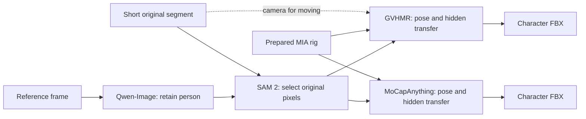
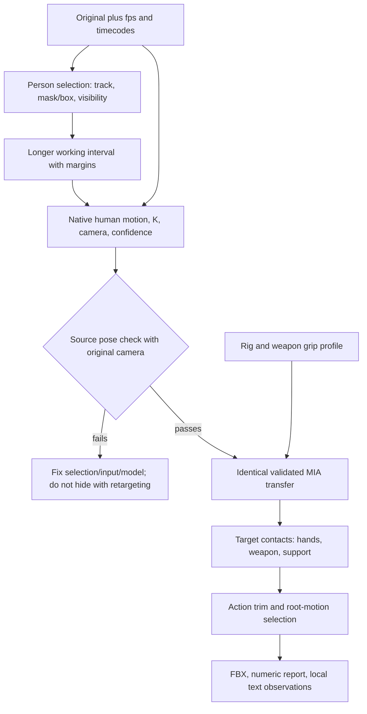

# Animation graph review — October 19, 2026

**Finding:** Studio → launcher → Flow is suitable. The experiment design is the
problem: neural capture, transfer and game polish are merged into one result,
without separately checking source quality and each transition. Adding another
model after FBX will not fix this.

Reviewed all **16 saved Flows**, adapter/transfer code, job parameters, earlier
numeric reports and six new local Qwen3.8 text reports. No images/video were
loaded into agent context. Graph snapshot:
`workspace/animation_graph_review/flow_snapshot.json`; summary: `inventory.json`.
Confirmed implementation properties are separated from quality hypotheses below.

## Actual main graph

`7d2156f19a3c4223b45c98dbb8e7aa72`, revision 4: five segments, 19 tasks.
Four Qwen-Image, five SAM 2, five GVHMR and five MoCapAnything jobs. One segment
reuses a saved corrected reference rather than generating another edit.

Qwen-Image **does not redraw the whole mocap input**. Its result selects the
person for SAM; the composite uses original pixels, better than independently
editing generated frames. The moving `feint_steps` branch really passes the
original into `camera_video`; camera estimation does not rely only on white.
`root_motion=world` retains travel/turns. Old `in-place` turn removal should not
be reintroduced as the explanation for this current fencing set.

## Confirmed problems and gaps

| Priority | Observation | Meaning | Change |
| --- | --- | --- | --- |
| P0 | Ordinary GVHMR jobs return only FBX; native prediction/camera are temporary | Cannot reliably locate reconstruction versus transfer errors without rerunning | Make source motion a standard pre-retarget artifact |
| P0 | Checks cover finite transforms, frame counts, normalized weights | They do not prove correct or usable motion | Separate technical validity from motion acceptance |
| P1 | Both models in main sword_prof graph receive segmented video only | Cannot establish whether segmentation helped here | Add same-person/time untreated or crop-only control |
| P1 | SAM needs an edited white-background reference | Selection depends on a generative stage that already produced incomplete bodies | Accept point/box/mask/track ID directly on original |
| P1 | Clips trimmed to 0.8–3 s before temporal inference | Lost pre/post-attack context; 24-model-frame clip especially suspect | Capture with temporal margins, then trim motion |
| P1 | 3D previews normalize initial heading/pelvis while source keeps its camera | Silhouette comparison mixes pose and viewpoint | Separate camera-space overlay and matched native/target previews |
| P1 | No node receives weapon, grip points or contact states | Arm rotations alone cannot guarantee two-handed grip | Controlled post-transfer grip/IK solve with known anchors |
| P1 | Working guard has 22 bones; full MIA graph uses `fingers=false` | Better finger prediction cannot add target fingers | Prepare appropriate hand rig/geometry and grip separately |
| P1 | Refinement partly judged by reduced jitter | Smoothing can hide lost strike speed and worse pose | Judge pose, contacts and timing separately; keep HTD optional |

Normalized weights may be anatomically wrong, but the working MIA + Mixamo
branch argues **against blindly rebuilding every rig**. Check source SMPL and
SMPL → MIA transfer first. Changing riggers cannot fix source reconstruction.

## Existing numerical evidence

1. Human head-keypoint confidence ~0.96, person ~631 px; some Sieg ~0.69–0.86,
   226–332 px. Observation conditions differ. Detector confidence is not proof
   of correct 3D pose.
2. Background removal is not consistently better: jump torso median 32.2° →
   35.9°, walk 12.8° → 15.1°, Human 10.6° → 11.3°. These no-ground-truth proxies
   do not support “clean background is always better”, nor prove which version
   is more accurate. Report:
   `workspace/sieg/posture_batch/input_and_posture_summary.json`.
3. Saved camera/global predictions give `R_global(t) @ R_incam(t).T`. With a
   configured static camera, it changes from the first frame by up to 8.83°
   on Human and 15.44° on jump, despite matching local body poses. **This is
   not an MIA transfer bug**: native predictions already differ. Check the
   static assumption and camera/world consistency; do not simply put
   camera-space coordinates into Y-up BVH. Moving cameras should not have
   a constant transform. Report:
   `workspace/animation_graph_review/camera_space_consistency.json`.
4. Human HTD: root-relative jerk −66.5%, peak wrist speed −29.8%, head-down
   proxy 22.4° → 33.0°. Automatic HTD is unjustified.
5. Six local Qwen reports in `workspace/qwen_video_review/`, each sampling
   two points per video. Useful questions, not causes or winner selection;
   small four-column layouts and differing cameras further limit assessment.
   Qwen's two-frame claims about dynamics are not speed measurements.

Camera/world consistency particularly matters: independent
[MoRo sections 5.4–5.5](https://arxiv.org/html/2601.16079v1) also discuss GVHMR/WHAM
camera/world differences and video agreement versus dynamic plausibility.
This motivates both checks, not a proven cause of every observed defect.

## Where the approach goes wrong

**Mandatory generative preprocessing.** We need stable person selection, not
prettier images. Prefer original RGB, track ID, box/mask prompts and retained
visibility. Segmentation is useful annotation/conditioning; white composites
remain an experimental branch. Removed/occluded detail is not recovered real data.

**Trimming actions too early.** Test the same interval with 1–2 seconds before
and after, within server limits, then trim the game clip after capture. This
is an A/B hypothesis, not an established cause of head lean. Arbitrary fixed
frame counts do not guarantee fixes; duplicating original 25 fps does not
create true 30/60-fps capture. Fast hands need actual source frame rate and
shutter speed.

**Treating mocap as finished game animation.** Transferring rotations between
proportions moves hands/feet. Rotation preservation cannot ensure contact with
one rigid sword. Need two grip anchors, a leading hand/weapon, off-hand IK,
elbow constraints and contact intervals. Bringing wrists together without
weapon axis/palm orientation does not define two-handed grip.
[Unity Two Bone IK](https://docs.unity3d.com/Packages/com.unity.animation.rigging@1.3/manual/constraints/TwoBoneIKConstraint.html)
describes target/hint limb control; applying it to grip is an engineering
recommendation, not a promise to recover an occluded sword.

**Adding more smoothing.** GVHMR already runs `postproc=True`,
`pp_static_joint[_cam]` and `process_ik`; claiming no support correction is
unfounded. A separate **target-rig** solve is needed after proportion changes,
with weapon contacts. Do not glue both feet down during airborne motion.

## Proposed graph

This is **the next experiment's design**, not an installed pipeline. Most
additions are artifacts, checks and deterministic processing, not more heavy
networks. Do not make every block an unnecessary pseudo-server: preparation
and solving can live in `animation_tools`, model stages in isolated environments.

Split GVHMR native motion and motion → target FBX into two one-output tasks.
Version native packages in servers; SMPL/MHR formats do not belong in the SDK.
Keep `video-to-motion` as a compatible shortcut. HTD can sit before retargeting
only after separate A/B testing. Preserve MoCapAnything's native joints,
rotations and rig metadata rather than pretending it is SMPL.

## Capture alternatives

Candidates for testing, **not measured sword_prof winners**:

| Candidate | Relevance | Limitations and decision |
| --- | --- | --- |
| **PromptHMR-video + BEDLAM2 checkpoints** | Original RGB, box/mask prompts, multiple people, video/world pipeline | First pose/selection replacement candidate. Temporal head uses GVHMR, so not fully independent. Default batch 16 at 896 px unverified on 8 GB; needs batch-one/sequential pilot |
| **MoRo, 3DV 2026** | Explicit occlusion and temporal modeling; released code, weights, custom-video demo | Independent static fencing test candidate. No fingers/face. Demo world view assumes identity camera; moving-camera integration separate. Authors' 70 FPS is on H200, not our GPU |
| **SAM 3D Body** | Independent body/hand/foot estimation and prompts; useful for rare-pose checks | Single-image, not turnkey temporal/world capture. MHR rather than SMPL needs a correct adapter; framewise use risks jitter. Start with small diagnostic pilot |
| **SAM-Body4D** | Combines segmentation, occlusion completion and temporal SAM 3D Body | Not first local choice: single-person without completion 14.49 GB; multiperson completion 35–53 GB, ~27 min on H800. Major 8 GB adaptation needed |
| **WHAM** | Alternative camera, path and support control | Use for specific camera/root hypothesis; age or architecture does not prove fencing superiority. Do not integrate without a defined test |

Sources checked October 19, 2026:

- [PromptHMR official code and BEDLAM2 weights](https://github.com/yufu-wang/PromptHMR),
  [GVHMR head, batch and masks](https://github.com/yufu-wang/PromptHMR/blob/3b566b7dbb28ce506c7ea972c18693f4c705ce8c/pipeline/phmr_vid.py).
- [MoRo official repository](https://github.com/mikeqzy/MoRo),
  [demo camera assumption](https://github.com/mikeqzy/MoRo/blob/1f18c4f0d6db55d6b00327fb35c3e8d8d2fbfe82/demo.py),
  [paper](https://arxiv.org/html/2601.16079v1).
- [Meta SAM 3D Body](https://github.com/facebookresearch/sam-3d-body).
- [SAM-Body4D](https://github.com/gaomingqi/sam-body4d),
  [memory/time profile](https://github.com/gaomingqi/sam-body4d/blob/21af1020979ef32ddf6be3597ef59a68bad2f1bf/assets/doc/resources.md).
- [WHAM official code](https://github.com/yohanshin/WHAM).

Do not dismiss MoCapAnything V2 as animal-only:
[the authors also show human skeletons](https://animotionlab.github.io/MoCapAnythingV2/).
Our README was too narrow. Arbitrary-skeleton capture still does not guarantee
two-handed grip; a human-specific control remains useful. Kimodo solves a
different task: text-to-motion generation, not exact source-fencing reproduction.

## Action order

1. **Locate errors first:** retain native motion/camera; render camera-space
   overlay and matched native/target views. Check Human and one sword_prof
   episode. No mass rerigging.
2. **Then input:** same track, raw/crop-only versus masked, with/without temporal
   margins; hold rig, model, camera and final interval fixed.
3. **Then one new model:** PromptHMR-video with original-RGB masks; independent
   static-camera MoRo occlusion check. Validate memory and native pose before
   expanding the graph.
4. **After acceptable source motion:** grip/IK and target-body support checks,
   then game-clip export. Do not enable HTD by default.
5. **Acceptance:** user approves a concrete pilot before scaling. Local VLM
   and technical tests help but do not replace that judgment.

This review did not mass-rerun jobs or install all candidates. The likely picture
combines ambiguous input, camera/world estimates and missing post-transfer
contacts; current evidence does not establish a single cause for all defects.

## PromptHMR controlled pilot (2026-10-19)

TripoSG was retired from the active catalog/launcher and its dedicated environment,
source cache and model weights were removed (8,107,991,040 bytes actual free-space
increase at cleanup). Hunyuan3D 2.1 was preserved.

A persisted Studio Flow now runs PromptHMR-video native inference and transfers
both its native result and saved GVHMR native output onto the same MIA guard.
See `workspace/prompthmr_pilot/README.md` and `flow_manifest.json`. The control
uses the successful Human segment, not the questionable sword_prof material.
No SDK changes, generated image edits or background replacement were used.
PromptHMR fits the 8 GB GPU with image batch one at the original 896 resolution.

The native projection residual against the shared input detector increased from
11.04 px (GVHMR) to 16.41 px (PromptHMR), while root-relative joint jerk decreased
from 457.10 to 356.05 m/s³. These are diagnostic proxies, not ground-truth quality.
Head posture already differs before retargeting. Do not promote the new model
based on smoother output alone. The pilot omits upstream global camera/floor
optimization and still imports previously extracted observations; automated
track extraction for new uploads remains an integration step.

Retain sword_prof as a stress set. Establish a cleaner continuous single-person
fencing control with visible feet and stable camera before scaling variants.
PromptHMR's research-only license also prevents treating it as an unrestricted
production replacement.

## SMPL → MIA: confirmed clavicle bug (2026-10-19)

A simple untextured SMPL-X mannequin was rerigged with MIA. A control with known
joints/weights separated transfer from neural rigging. Zero SMPL rotations
raised both MIA shoulders about 9.2 cm: `smpl` wrongly applied neutral clavicle
direction alignment to an already neutral target. Neutral clavicles are now
preserved while actual rotations transfer. MIA + Mixamo `rotations` is unchanged.

Mean 120-frame surface deviation fell 6.04 → 3.86 cm for GVHMR and 5.80 → 3.58 cm
for PromptHMR. This compares a same-shape native body, not ground truth. Numeric
head/chest positions did not change; this does not fix source-model pose errors.

Experiment, saved graphs, old-guard before/after and standalone frame review:
`workspace/rigging_lab/README.md` and `index.html`. Fourteen Blender regressions
cover actual clavicle rotations, neutral pose and three root modes. Optional
`matched-neutral` is only for already matching neutral surfaces, not a default.

Qwen received 16 large individual-frame comparisons. Contact sheets with small
pairs misreported row/frame counts and were excluded. Even large descriptions
sometimes claim head changes absent from numeric data. VLM is not an automatic
acceptance test. SkinTokens/UniRig were deferred at the user's request.

After shoulder fixes, a separate guard-foot defect was reproduced: zero SMPL
rotations added 23.09/23.73° to feet/toes. Different neutral ankle→toe vector
tilts were wrongly treated as sole angles. SMPL now preserves neutral foot/toe
orientation while transferring actual rotation. This is a general fix without
individual guard offsets. Across all 120 GVHMR/PromptHMR frames, heads, shoulders
and ankle positions stayed unchanged. Artifacts: `workspace/rigging_lab/feet_*`.
