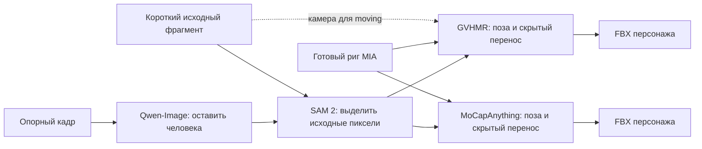
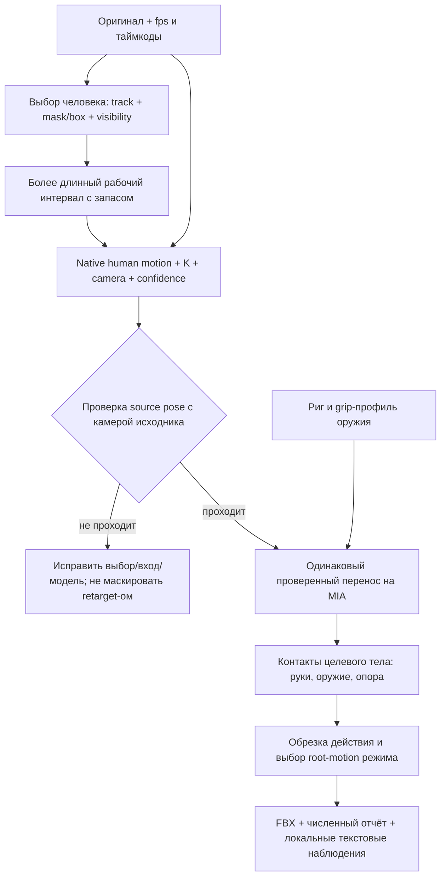

# Ревью графов анимации — 19 октября 2026

**Вывод:** архитектура Studio → launcher → Flow подходит для этой работы.
Проблема в содержании экспериментов: нейросетевой захват, перенос и игровая
доводка объединены в один результат; качество источника и каждого перехода
не проверяется отдельно. Добавление ещё одной модели после FBX это не исправит.

Проверены все **16 сохранённых Flow**, код адаптеров и переноса, параметры
заданий, прежние численные отчёты и шесть новых текстовых отчётов локальной
Qwen3.8. Изображения/видео в контекст агента не загружались. Снимок графов:
`workspace/animation_graph_review/flow_snapshot.json`; сводка — `inventory.json`.
Здесь подтверждённые свойства реализации отделены от гипотез о качестве.

## Как фактически устроен главный граф

`7d2156f19a3c4223b45c98dbb8e7aa72`, ревизия 4: пять фрагментов, 19 задач.
Есть четыре Qwen-Image, пять SAM 2, пять GVHMR и пять MoCapAnything.
Для одного фрагмента используется уже сохранённая исправленная референсная
картинка вместо нового задания редактирования.

Важно: Qwen-Image **не перерисовывает весь мокап-вход**. Её результат задаёт
выбор человека в SAM; композит строится из оригинальных пикселей.
Это уже лучше независимого генеративного редактирования кадров.
В moving-ветке `feint_steps` оригинал действительно подан в `camera_video`;
текущий граф не оценивает камеру только по белому фону. `root_motion=world`
сохраняет путь/повороты. Старое удаление поворота режимом `in-place` не надо
повторно объявлять причиной текущего фехтовального набора.

## Подтверждённые проблемы и пробелы

| Приоритет | Наблюдение | Что это означает | Изменение |
| --- | --- | --- | --- |
| P0 | Обычный GVHMR job возвращает только FBX; native prediction и камера живут во временной папке | Не удаётся надёжно локализовать ошибку между реконструкцией и переносом без нового прогона | Сделать исходное движение штатным артефактом до retarget |
| P0 | Проверяются конечность трансформов, число кадров и нормировка весов | Эти проверки не доказывают верную позу или пригодность движения | Разделить техническую валидность и приёмку движения |
| P1 | В основном графе sword_prof обе модели получают только сегментированное видео | Нельзя установить, помогла ли сегментация именно здесь | Добавить untreated/crop-only контроль с тем же человеком и временем |
| P1 | Вход SAM требует отредактированный референс на белом | Выбор человека зависит от генеративного шага, который уже выдавал неполное тело | Принимать точку/box/готовую маску/track ID непосредственно на оригинале |
| P1 | Короткий клип обрезается до temporal inference; диапазоны — 0,8–3 с | Контекст до атаки и после неё теряется; особенно подозрителен клип на 24 model-кадра | Сначала захват с временными запасами, затем обрезка готового движения |
| P1 | Превью 3D нормализует начальные heading и pelvis, исходник сохраняет свою камеру | Прямое сравнение силуэтов смешивает позу и различие ракурсов | Отдельный incam overlay и отдельное одинаковое превью native/target |
| P1 | Ни один узел не получает оружие, точки хвата или состояния контакта | Двуручный хват не обеспечивается предсказанием вращений рук | После переноса добавить управляемый grip/IK solve с известными anchors |
| P1 | У рабочего стражника 22 кости; в полном MIA-графе `fingers=false` | Более точная модель пальцев сама по себе не даст пальцев на этой цели | Для нужных рук отдельно подготовить подходящий rig/геометрию и хват |
| P1 | Refinement оценивался в том числе по снижению дрожания | Сглаживание может скрыть потерю ударной скорости и ухудшение позы | Оценивать позу, контакты и timing отдельно; HTD оставить optional |

Нормализованные веса могут быть анатомически неверными. Но работающая
MIA + Mixamo ветка — аргумент **не переделывать весь риг вслепую**.
Сначала нужно проверить отдельный переход SMPL → MIA и исходный SMPL.
Подмена модели риггинга не исправит ошибку исходной реконструкции.

## Что показали имеющиеся численные данные

1. У Human head-keypoint confidence около 0,96, размер человека около 631 px;
   у некоторых Sieg — около 0,69–0,86 и 226–332 px. Это разные условия
   наблюдения. Confidence — оценка детектора, не доказательство верной 3D-позы.
2. Удаление фона не даёт монотонного выигрыша: например, у jump медианный
   наклон корпуса меняется с 32,2° до 35,9°, у walk — с 12,8° до 15,1°.
   Для Human — 10,6° → 11,3°. Это диагностические прокси без эталонного 3D;
   они не поддерживают предположение «чистый фон обязательно лучше», но сами
   по себе не доказывают, какая версия точнее. Исходный отчёт:
   `workspace/sieg/posture_batch/input_and_posture_summary.json`.
3. На сохранённых предсказаниях сравнен переход между камерной и глобальной
   системами: `R_global(t) @ R_incam(t).T`. При настроенной статичной камере
   он меняется относительно первого кадра до 8,83° на Human и 15,44° на jump,
   хотя параметры локальной позы тела совпадают. Это **не ошибка переноса
   на MIA**: разница уже есть в native prediction. Нужно проверить истинность
   static-предположения и согласованность camera/world оценок; нельзя просто
   подать камерные координаты в Y-up BVH. Для moving-камеры постоянство
   этого преобразования вообще не ожидается. Отчёт:
   `workspace/animation_graph_review/camera_space_consistency.json`.
4. HTD на Human: root-relative jerk −66,5%, peak wrist speed −29,8%,
   head-down proxy 22,4° → 33,0°. Автоматическое включение HTD не оправдано.
5. Шесть локальных Qwen-отчётов сохранены в `workspace/qwen_video_review/`.
   Каждое видео оценено лишь в двух точках. Они полезны для списка вопросов,
   но не устанавливают причины и победителя; мелкие четыре колонки и разные
   камеры дополнительно ограничивают такую оценку. Предположения Qwen о
   «динамике» по двум кадрам нельзя принимать как измерение скорости.

Проверка camera/world согласованности особенно важна: независимая статья
[MoRo, разделы 5.4–5.5](https://arxiv.org/html/2601.16079v1) также рассматривает
разницу camera- и world-результатов GVHMR/WHAM и компромисс между совпадением
с видео и динамической правдоподобностью. Это объясняет необходимость двух
проверок; не доказывает причину каждого нашего дефекта.

## Где мы идём не тем путём

**Генеративное редактирование как обязательная подготовка.** Нужен стабильный
выбор человека, а не более красивая картинка. Предпочтительны исходный RGB,
track ID, box/mask prompts и сохранённая видимость. Сегментация полезна как
разметка/условие; белый композит остаётся одной проверяемой веткой. Удалённые
или перекрытые детали нельзя считать восстановленными реальными данными.

**Отрезать действие слишком рано.** Обработать, например, тот же интервал
с 1–2 с до/после в пределах лимита сервера, а конечный игровой клип выделить
после захвата. Это гипотеза для A/B, не установленная причина текущего наклона
головы. Удлинение до произвольного фиксированного числа кадров не гарантирует
исправления; оригинальные 25 fps не превращаются в настоящий 30/60-fps захват
от повторения кадров. Для быстрых рук важны исходная частота и выдержка.

**Считать mocap готовой игровой анимацией.** Перенос вращений на другие
пропорции меняет положение кистей/стоп. Сохранить вращения недостаточно для
контакта с одним жёстким мечом. Нужны два grip anchors, ведущая рука/оружие,
IK второй руки, ограничения локтя и интервалы контакта. Простое сближение
кистей без оси оружия/ориентации ладоней не задаёт двуручный хват.
[Two Bone IK Unity](https://docs.unity3d.com/Packages/com.unity.animation.rigging@1.3/manual/constraints/TwoBoneIKConstraint.html)
описывает управление конечностью через target и hint; применение к хвату
здесь — инженерная рекомендация, а не обещание восстановить скрытый меч.

**Добавлять ещё одно сглаживание.** GVHMR уже запускает `postproc=True`,
`pp_static_joint[_cam]` и `process_ik`. Нет основания утверждать, что у него
совсем отсутствует коррекция опоры. Отдельный solve нужен на **целевом** риге
после изменения пропорций и с контактами оружия. Для отрыва стоп он не должен
принудительно приклеивать обе ноги к полу.

## Предлагаемый граф

Это **проект следующего эксперимента**, не уже установленный pipeline.
Большинство добавлений — артефакты, проверки и детерминированная обработка,
а не ещё несколько тяжёлых нейросетей. Нельзя превратить каждый блок в новый
«псевдосервер» без необходимости: подготовку/solve можно разместить в
существующем `animation_tools`, модельные стадии — в отдельных окружениях.

Для GVHMR логично разделить «native motion» и «motion → target FBX» на две
задачи с одним выходом каждая. Пакет native motion версионируется сервером;
формат SMPL/MHR не должен попадать в SDK. Текущий `video-to-motion` можно
сохранить как совместимый shortcut. HTD возможна между native motion и
retarget, только после отдельного A/B. Для MoCapAnything нужно сохранять
его native joints/rotations/rig metadata, не притворяться, что это SMPL.

## Кандидаты вместо текущего захвата

Это кандидаты на проверку, **не измеренные победители на sword_prof**.

| Кандидат | Почему соответствует нашей проблеме | Ограничения и решение |
| --- | --- | --- |
| **PromptHMR-video + BEDLAM2 checkpoints** | Оригинальный RGB + box/mask prompts, несколько людей, video/world pipeline | Первый кандидат для смены получения позы/выбора человека. В опубликованном коде temporal head основан на GVHMR, поэтому это не полностью независимый захват. Default batch 16 при 896 px не подтверждён на наших 8 ГБ; нужен batch-1/последовательный пилот |
| **MoRo, 3DV 2026** | Специально моделирует перекрытия и последовательность движения; выпущены код, веса и custom-video demo | Независимый кандидат для одного статичного фехтовального теста. Не предсказывает пальцы/лицо. Demo world-view предполагает identity camera, moving-ветку надо интегрировать отдельно; 70 FPS у авторов измерены на H200, не на нашей карте |
| **SAM 3D Body** | Независимая оценка тела, кистей и стоп, prompts; полезен для проверки редких поз | Это single-image модель, не готовый temporal/world mocap. MHR вместо SMPL — нужен корректный адаптер; покадровый запуск сам по себе создаёт риск дрожания. Сначала маленький диагностический пилот, не массовая замена |
| **SAM-Body4D** | Уже объединяет сегментацию, восстановление перекрытий и SAM 3D Body во времени | Не первый локальный выбор: опубликованный single-person пример без completion — 14,49 GB; multi-person completion — 35–53 GB и около 27 минут на H800. Нужна существенная адаптация для 8 ГБ |
| **WHAM** | Альтернативный контроль камеры, траектории и опоры | Полезны для конкретной camera/root гипотезы; возраст/другая архитектура не доказывают превосходства в фехтовании. Не подключать без сформулированного теста |

Источники проверены 19 октября 2026:

- [PromptHMR, официальный код и BEDLAM2 веса](https://github.com/yufu-wang/PromptHMR),
  [использование GVHMR head, batch и masks](https://github.com/yufu-wang/PromptHMR/blob/3b566b7dbb28ce506c7ea972c18693f4c705ce8c/pipeline/phmr_vid.py).
- [MoRo, официальный репозиторий](https://github.com/mikeqzy/MoRo),
  [camera assumption в demo](https://github.com/mikeqzy/MoRo/blob/1f18c4f0d6db55d6b00327fb35c3e8d8d2fbfe82/demo.py),
  [статья](https://arxiv.org/html/2601.16079v1).
- [SAM 3D Body, официальный репозиторий Meta](https://github.com/facebookresearch/sam-3d-body).
- [SAM-Body4D](https://github.com/gaomingqi/sam-body4d),
  [профиль памяти и времени](https://github.com/gaomingqi/sam-body4d/blob/21af1020979ef32ddf6be3597ef59a68bad2f1bf/assets/doc/resources.md).
- [WHAM, официальный код](https://github.com/yohanshin/WHAM).

MoCapAnything V2 не надо ошибочно списывать как «только для животных»:
[авторы показывают и человеческие скелеты](https://animotionlab.github.io/MoCapAnythingV2/).
В нашем README описание было слишком узким. Но arbitrary-skeleton capture
не гарантирует двуручного хвата; для человеческих действий отдельный
human-specific контроль всё равно полезен. Kimodo решает другую задачу —
генерацию движения по тексту, а не точное повторение исходного фехтования.

## Порядок действий

1. **Сначала локализация ошибки:** сохранить native motion и camera; вывести
   incam overlay и native/target в одинаковом ракурсе. Проверить source/target
   позы на Human и одном sword_prof эпизоде. Никакого массового перерига.
2. **Затем вход:** один и тот же track, raw/crop-only vs masked, с/без временных
   запасов. Держать неизменными риг, модель, камеру и конечный диапазон.
3. **Затем одна новая модель:** PromptHMR-video с маской на оригинальном RGB;
   независимая проверка MoRo для перекрытий при статичной камере. Проверить
   потребление памяти и native-позу прежде, чем подключать весь граф.
4. **После приемлемого source motion:** grip/IK и проверка опоры на целевом
   персонаже; экспорт игровых клипов. HTD не включать по умолчанию.
5. **Приёмка:** пользователь подтверждает конкретный пилот, затем масштабируем
   набор. Локальный VLM и технические тесты помогают, но не заменяют эту оценку.

Массовые повторные прогоны и установка всех перечисленных моделей в рамках
этого ревью не выполнялись. Самая вероятная картина — сочетание неоднозначного
входа, camera/world оценок и отсутствия контактов после переноса; одной
подтверждённой причиной всех дефектов текущие данные не располагают.

## PromptHMR controlled pilot (2026-10-19)

TripoSG was retired from the active catalog/launcher and its dedicated environment,
source cache and model weights were removed (8,107,991,040 bytes actual free-space
increase at cleanup). Hunyuan3D 2.1 was preserved.

A persisted Studio Flow now runs PromptHMR-video native inference and transfers
both its native result and saved GVHMR native output onto the same MIA guard.
See `workspace/prompthmr_pilot/README.md` and `flow_manifest.json`. The control
uses the successful Human segment, not the questionable sword_prof material.
No SDK changes, generated image edits or background replacement were used.
PromptHMR fits the 8 GB GPU with image batch one at the original 896 resolution.

The native projection residual against the shared input detector increased from
11.04 px (GVHMR) to 16.41 px (PromptHMR), while root-relative joint jerk decreased
from 457.10 to 356.05 m/s³. These are diagnostic proxies, not ground-truth quality.
Head posture already differs before retargeting. Do not promote the new model
based on smoother output alone. The pilot omits upstream global camera/floor
optimization and still imports previously extracted observations; automated
track extraction for new uploads remains an integration step.

Retain sword_prof as a stress set. Establish a cleaner continuous single-person
fencing control with visible feet and stable camera before scaling variants.
PromptHMR's research-only license also prevents treating it as an unrestricted
production replacement.

## SMPL → MIA: подтверждённая ошибка ключиц (2026-10-19)

Построен простой нетекстурированный манекен на геометрии SMPL-X и заново
заригжен MIA. Контроль с известными суставами/весами отделил перенос от
нейросетевого риггинга. Нулевые вращения SMPL поднимали оба плеча MIA примерно
на 9,2 см: профиль `smpl` ошибочно применял нейтральное выравнивание направлений
ключиц к уже нейтральному целевому телу. Теперь нейтральные ключицы сохраняются,
а реальные вращения переносятся. Путь `rotations` для MIA + Mixamo не менялся.

Среднее отклонение поверхности на 120 кадрах уменьшилось с 6,04 до 3,86 см
для GVHMR и с 5,80 до 3,58 см для PromptHMR. Это сопоставление с нативным телом
одной формы, не ground truth. Численные положения головы/груди при исправлении
не менялись: этот фикс не решает исходную ошибку позы мокап-модели.

Эксперимент, сохранённые графы, до/после на прежнем стражнике и автономный
покадровый просмотр: `workspace/rigging_lab/README.md` и `index.html`.
14 Blender-регрессий проверяют в том числе реальные вращения ключиц,
нейтральную позу и три режима корня. Дополнительный `matched-neutral` режим
доступен только для уже совпадающей нейтральной позы поверхности, не по умолчанию.

Qwen получил 16 крупных сравнений конкретных кадров. Попытки свести несколько
маленьких пар в один лист давали неверное число строк/кадров и исключены из
доказательств. Даже крупные описания иногда утверждают изменение головы,
которого нет в численных данных. Поэтому VLM не является автоматическим
приёмочным тестом. SkinTokens и UniRig отложены по просьбе пользователя.

После исправления плеч отдельно воспроизведён дефект стоп стражника:
нулевые вращения SMPL добавляли 23,09/23,73° к стопам и носкам. Разница наклона
векторов ankle→toe в нейтральных скелетах ошибочно использовалась как угол
подошвы. Профиль SMPL теперь сохраняет нейтральную ориентацию также стоп и
носков, передавая их реальные вращения. Это общий фикс, без индивидуальных
поправок стражника. Проверены все 120 кадров GVHMR/PromptHMR: головы, плечи
и положения голеностопов не изменились. Артефакты `workspace/rigging_lab/feet_*`.
