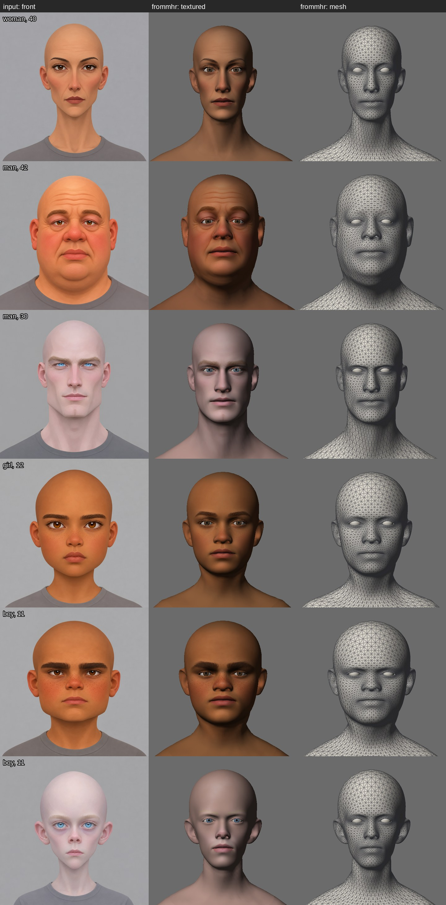

# frommhr

A reader for two pictures of a bald head, the front and the left profile, on
a plain backdrop. It reads the head's shape as the 20 head coefficients of
Meta's Momentum Human Rig (MHR), and its colour as 14 pigment sliders: skin,
cheeks, nose, under the eyes, lips, brows, irises and stubble. It was trained
only on renders of random MHR people on NVIDIA's SOMA mesh, made on the fly.



*The example on the [model card](https://huggingface.co/zjgkkn/frommhr) on
Hugging Face. Left, a generated front picture (not a photo of a real person);
the reader also got the head's left profile. Middle, the person Assets
Studio's server builds from the reader's output, the head's colour projected
from the pictures. Right, the same mesh without colour: SOMA's triangles, the
head shaped by the reader's 20 coefficients. The children (the three bottom
rows) get the closest adult head, since MHR's identity space was built from
adults.*

The reader, with what it needs to rebuild the head, is published on Hugging
Face as [zjgkkn/frommhr](https://huggingface.co/zjgkkn/frommhr) (Apache-2.0),
with a model card and an inference script; `hf/` holds both. Assets Studio
runs it as the [`frommhr` server](../assets_studio/model_servers/fromsoma/README.md),
which puts the head on a rigged, textured SOMA person.

On 256 random MHR people held out from training, the rebuilt head's skin lies
0.27 mm from the truth on average, against 4.5 mm for MHR's mean head. The
model card has the full table.

## Files

| File | Does |
| --- | --- |
| `download.py` | SOMA-X's files from Hugging Face (`nvidia/soma-x`, v0.3.3) |
| `prep.py` | the training data: MHR's identity on SOMA's mesh as a linear model, the materials, the feature masks |
| `mhr_heads.py` | builds MHR heads from the data: the skin, the eyes, a whole person |
| `heads.py` | renders a head's front and profile with its features (masks, lashes, irises, light) |
| `colour.py`, `pigments.py`, `hemoglobin.csv` | the colour of skin and features from melanin and blood, and the 14 sliders |
| `raster.py` | a small PyTorch rasteriser, for the renders and the baked masks |
| `train.py` | trains the reader on renders made on the fly |
| `evaluate.py` | measures a reader on held-out random people |
| `export.py`, `package.py` | pack a trained reader into one safetensors file |
| `hf/` | what Hugging Face carries besides the package: the model card and `predict.py` |
| `requirements.txt` | the packages this code was tested with |
| `data/` | everything downloaded, prepared or trained; git-ignored, never published |

## Environment

```sh
uv venv --python 3.12 .venv
uv pip install --python .venv/bin/python -r requirements.txt
```

Add a CUDA build of PyTorch to train (`--extra-index-url
https://download.pytorch.org/whl/cu128` and `--index-strategy
unsafe-best-match`). The data, the evaluation and the export run on the CPU.
`hf/predict.py` also needs `mediapipe`.

Run the scripts from this directory, since they import one another. `data/`
holds only downloaded files and outputs, never code.

## Data

```sh
python download.py
python prep.py
```

`download.py` fetches the SOMA-X files `prep.py` and `export.py` read into
`data/soma-x/`. Pin v0.3.3: it is the version the published reader was made
with, and later versions change the pose correctives the code does not use.

`prep.py` writes `data/data.pt` (about 50 MB) in a few minutes on the CPU,
with about 4 GB of RAM:

- MHR's rest shape on SOMA's mesh, as a linear model: the mean, the 20 body
  directions (coefficients 0–19) and the 20 head directions (20–39). MHR is
  linear in the head coefficients within 1.8 mm at the worst vertex, 0.04 mm
  on average. The head's directions are smoothed over 5 mm of skin; vertex by
  vertex they tear the mouth's corners open on some people.
- The eye joints, through SOMA's linear regression of joints from vertices.
- SOMA's materials: the mouth and eye bags are cavities.
- The feature masks in Anny's UVs (MPFB2's lips, eyelids and ears, and three
  brow shapes drawn here), baked into SOMA's first UV tile through SOMA-X's
  Anny correspondence.

## Training

```sh
python train.py --size 518 --checkpointing
```

Each step draws random people: body and head coefficients from N(0, 1)
clipped at 2.5, the 14 sliders from `colour.py`'s prior, random light and a
random grey backdrop. Each person is rendered orthographically from the
front and the left, each picture framed to its own head as `predict.py`
frames a photo. The heads turn a little (up to 6° sideways, 5° up or down, 3°
tilted); each picture is shifted, scaled, turned, sometimes blurred or halved
in resolution, gamma-shifted and noised.

The network: DINOv2 ViT-S/14 (timm's `vit_small_patch14_dinov2.lvd142m`) at
518 px on both pictures, a small CNN on the front picture's eye strip (the
transformer's features held no iris colour), and an MLP from [CLS, mean patch
token] of each view and the CNN's features to the 20 coefficients and the 14
slider logits.

The loss rebuilds the head's skin from the predicted coefficients with the
true body. Both heads are centred and scaled to an adult's head size, since
each picture is framed to its own head; the mean distance counts in mm. To it
come 0.5 × the coefficients' squared error, 5 × the sliders' squared error
and 0.02 × the CIE76 difference of the colours they give (skin, cheeks, nose,
under the eyes, lips, brows, irises). The EMA weights are validated every 15
minutes on 256 fixed people; `data/run/best.pt` keeps the best by val_mm +
0.02 dE.

The learning rate warms up over 500 steps, then follows a cosine to the end
by the wall clock (`--hours`, or `--deadline HH:MM`), so a run stopped and
resumed still ends annealed. A run resumes from `data/run/last.pt`; on CUDA
it pauses between steps while the GPU is hotter than `--max-temp`.

The published reader ran 6.8 hours on an RTX 3070 Laptop GPU (8 GB): batch
32, `--lr 2e-5 --eyes-lr 1e-3 --checkpointing`, about 8 people per second,
6 502 steps, 4.1 GB of GPU memory. It did not start from DINOv2's weights but
from an earlier reader of ours, the same network trained on renders of
another body model (Anny), which is not published. `train.py` starts from
DINOv2 by default; from there it has been tested, not run to the end, and
will likely need a longer run for the same error. `--init` starts from any
checkpoint or package instead. The weights were trained with PyTorch 2.8 and
CUDA 12.9; this code was tested with `requirements.txt`.

## Evaluation

```sh
python evaluate.py --weights data/run/best.pt
```

256 random people from a seed the training never uses (999). It writes
`data/eval/eval.json` and `eval_people.png` (input, prediction, truth):

- the head skin's error in mm, as in the loss, against MHR's mean head on the
  true body and against one average head for everybody;
- R² of each head coefficient;
- CIE76 colour differences per feature, the error of melanin and blood, and
  of the stubble.

`--weights` takes an exported package too.

## Export and inference

```sh
python export.py
python hf/predict.py front.png profile.png --package data/frommhr.safetensors \
  --obj head.obj
```

`export.py` packs `best.pt`'s EMA weights into `data/frommhr.safetensors`
with what the reader's users need, so they hold no training code or MHR
files: the training constants, MHR's identity on SOMA's mesh (also in SOMA's
bind pose, for the Studio server's body fit), SOMA's triangles, the colour
tables and the feature masks. About a minute on the CPU and 3 GB of RAM.

A package is one safetensors file (`package.py`): the tensors under dotted
keys, the rest as JSON in its metadata, each tensor there as `{"$tensor":
key}`. Loading it runs no code, unlike a pickle.

`predict.py` reads the pictures as the Studio server does and prints the
coefficients and pigments as JSON; `--obj` writes the head on MHR's mean
body. Without `--package` it downloads the published one.

To publish a new version, upload `hf/README.md`, `hf/predict.py` and
`data/frommhr.safetensors`, nothing else from `data/`.

## Licences

The code is Apache-2.0. It uses SOMA-X (NVIDIA), MHR (Meta), Anny (NAVER
LABS Europe), DINOv2 (Meta) and MediaPipe's Face Landmarker (Google), all
Apache-2.0, and MPFB2's lip, eyelid and ear masks that Anny carries (CC0).
`hemoglobin.csv` is Scott Prahl's tabulation of haemoglobin's molar
extinction (omlc.org).
