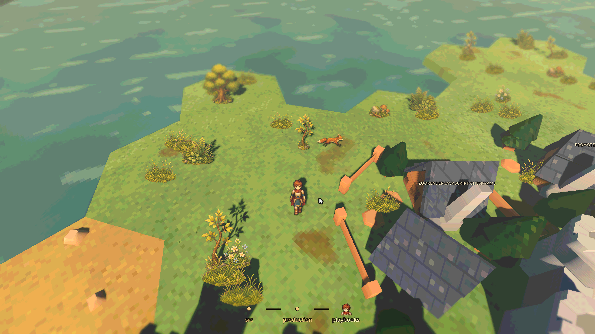
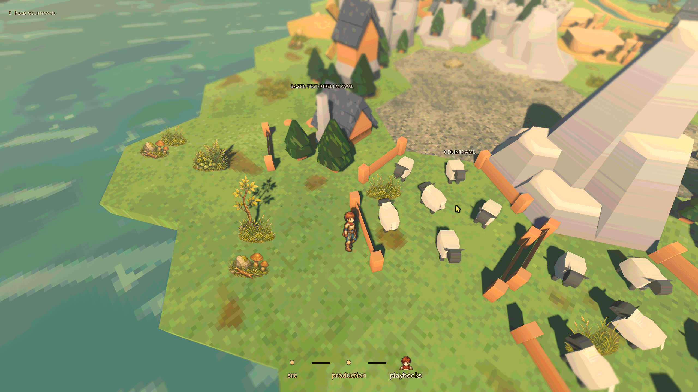
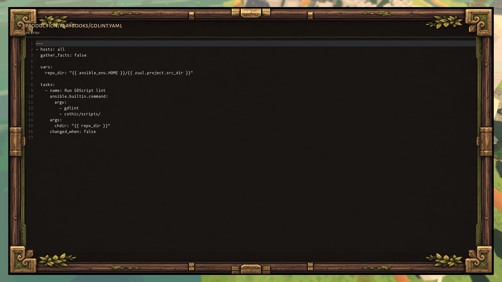
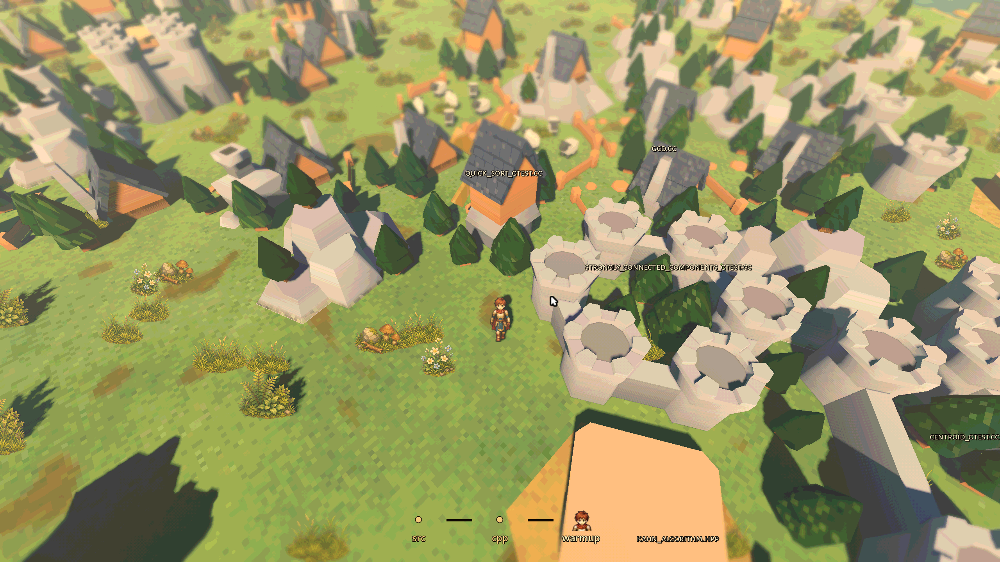
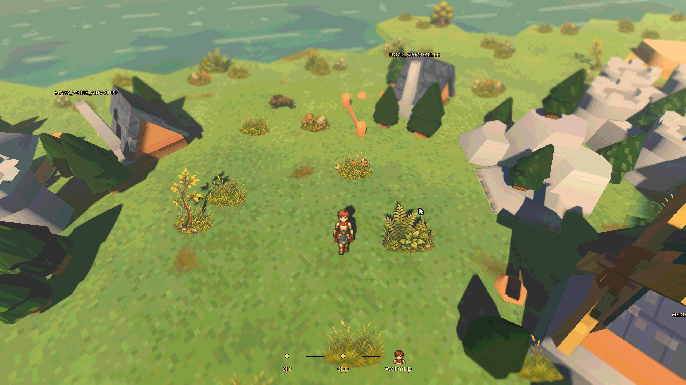
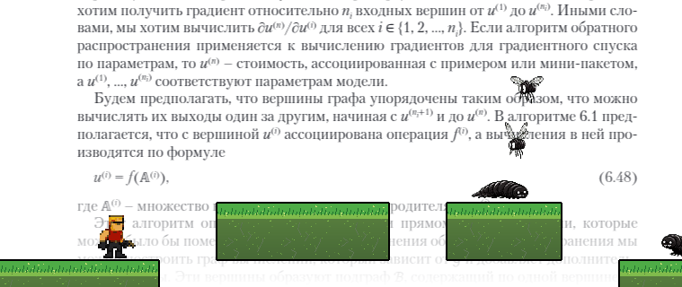

# Games

Games and development tools created with LLM assistance to explore and test models.
Run the commands below from the repository root.

## Cothic

[`cothic`](cothic) is a Godot 4.6 prototype that turns a real codebase
into a cozy, explorable isometric world.

Each repository directory becomes a procedurally generated location:
connected islands, beaches, rivers, terrain dressing, file buildings,
and directory portals are built from the structure of the selected
project. Files can be opened in-game, directories can be traversed
through portals or fast travel, and text files can be read in a
read-only in-game viewer.

The world combines stylized 3D terrain with detailed 2D sprites, an
eight-direction animated hero, roaming wildlife, animated water, and
procedural vegetation. A fantasy-inspired reader, map, and path navigation.

<!-- markdownlint-disable MD013 MD033 -->
<p>
  <a href="../static/cothic/img1.png"></a>
  <a href="../static/cothic/img2.png"></a>
  <a href="../static/cothic/img3.png"></a>
  <a href="../static/cothic/img4.png"></a>
  <a href="../static/cothic/img5.png"></a>
</p>
<!-- markdownlint-enable MD013 MD033 -->

## Zooreader

[`zooreader`](zooreader) — A
zero-player platform game layered over PDF reading. The protagonist
independently traverses platforms and fights enemies as the reader
progresses through the page. With an LLM, it can also make brief
comments about the page content.



## YAQS

[`yaqs`](yaqs) is a local game-development knowledge library for people
and agents. It combines SQLite, sqlite-vec and FTS5 with Qwen3 embeddings
for semantic search across languages, with book and page citations.

The CLI and MCP server support search, neighboring passages and full-page
reading. The database, source books and model weights are not included;
import your own UTF-8 TXT or JSONL documents.

```sh
just yaqs setup
just yaqs import /path/to/book.jsonl
just yaqs search "How can level design guide the player?"
just yaqs serve
```
