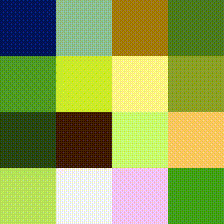
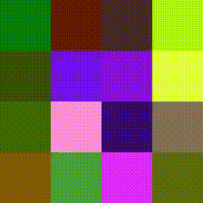

# Pet Project: Evolutionary Art

An experimental evolutionary algorithm that draws images with pixels, using
an ImageNet-trained model as the fitness function. It "evolves" images from
random pixels into recognizable shapes.

An image is a grid of coloured cells, slightly blurred. A population of such
grids breeds by crossover and mutation, and the best one is always kept. Its
fitness is the raw logit of one ImageNet class: the lowest over the image,
its mirror image and the models used (ResNet-50 or MobileNetV2 in ONNX). The
grid starts at 4×4 cells and is refined whenever the fitness stops growing,
up to 128×128.

`config.json` sets the class, the population, the grid and the paths to the
models, which are not in the repository; `main.cc` takes the config's path
and saves the best image every few generations. It builds with Bazel and
ONNX Runtime (`onnx_config.bzl`).
